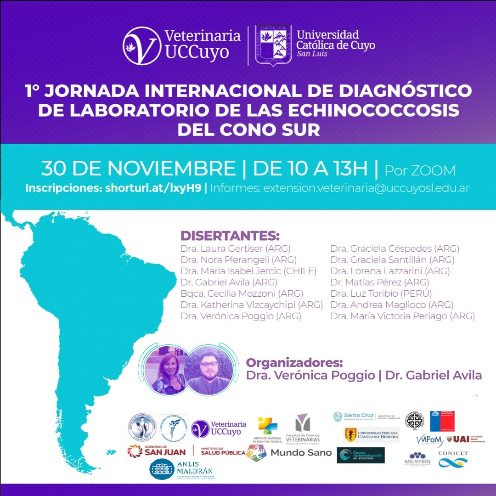

El **lunes 30 de noviembre de 2020, de 10 a 13 h** (hora argentina), se realizará por Zoom la **1.ª Jornada Internacional de Diagnóstico de Laboratorio de las Echinococcosis del Cono Sur**, organizada por la Facultad de Veterinaria de la **Universidad Católica de Cuyo, sede San Luis**.

La actividad es **gratuita, con inscripción previa**, y la organizan la Dra. Verónica Poggio y el Dr. Gabriel Ávila.

## Disertantes

Dra. Laura Gertiser, Dra. Nora Pierangeli, Dra. María Isabel Jercic (Chile), Dr. Gabriel Ávila, Bqca. Cecilia Mozzoni, Dra. Katherina Vizcaychipi, Dra. Verónica Poggio, Dra. Graciela Céspedes, Dra. Graciela Santillán, Dra. Lorena Lazzarini, Dr. Matías Pérez, Dra. Luz Toribio (Perú), Dra. Andrea Maglioco y Dra. María Victoria Periago.

**Inscripción:** [formulario en línea](https://docs.google.com/forms/d/1rfQ8vXH5mPd7hVUG6KTO7HrMD6-D0Fu0xfV4N6-NMaE/viewform). **Consultas:** extension.veterinaria@uccuyosl.edu.ar
