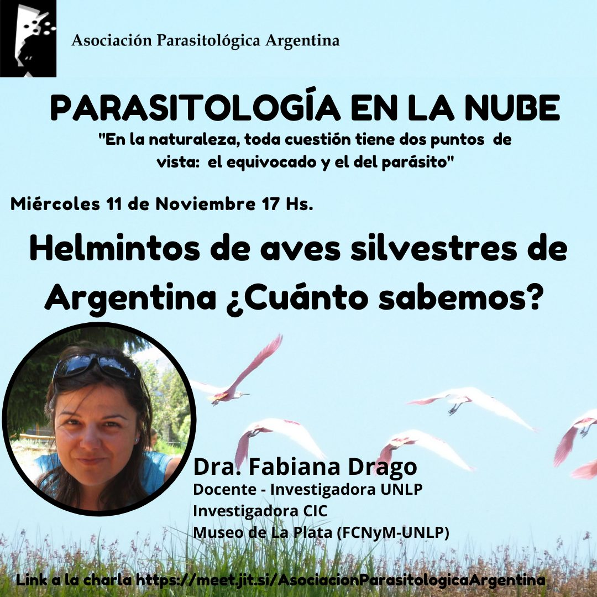

El ciclo **Parasitología en la Nube** de la APA continúa el **miércoles 11 de noviembre a las 17 h** con la charla **«Helmintos de aves silvestres de Argentina ¿Cuánto sabemos?»**.

La expositora será la **Dra. Fabiana Drago**, docente e investigadora de la UNLP e investigadora de la CIC en el Museo de La Plata (FCNyM-UNLP).

Podés ver la charla aquí:


