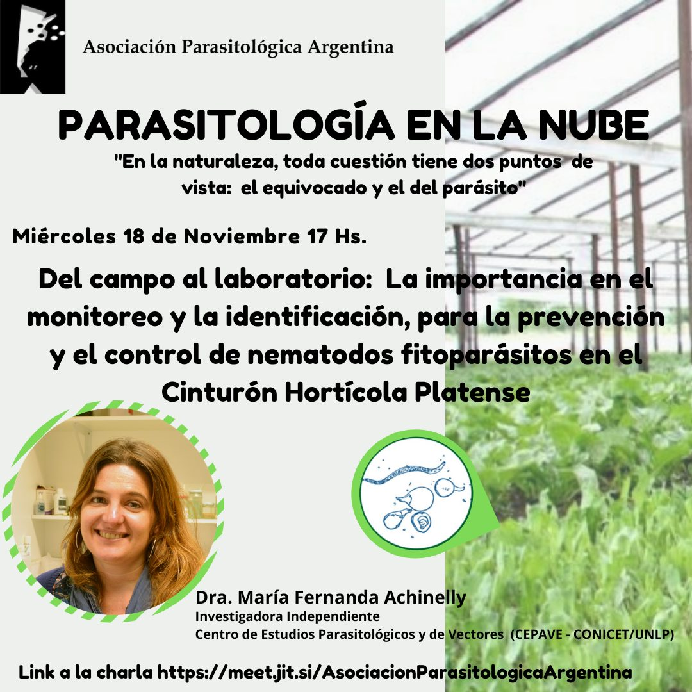

El ciclo **Parasitología en la Nube** de la APA continúa el **miércoles 18 de noviembre a las 17 h** con la charla **«Del campo al laboratorio: la importancia en el monitoreo y la identificación, para la prevención y el control de nematodos fitoparásitos en el Cinturón Hortícola Platense»**.

La expositora será la **Dra. María Fernanda Achinelly**, investigadora independiente en el Centro de Estudios Parasitológicos y de Vectores (CEPAVE, CONICET-UNLP).

Podés ver la charla aquí:


