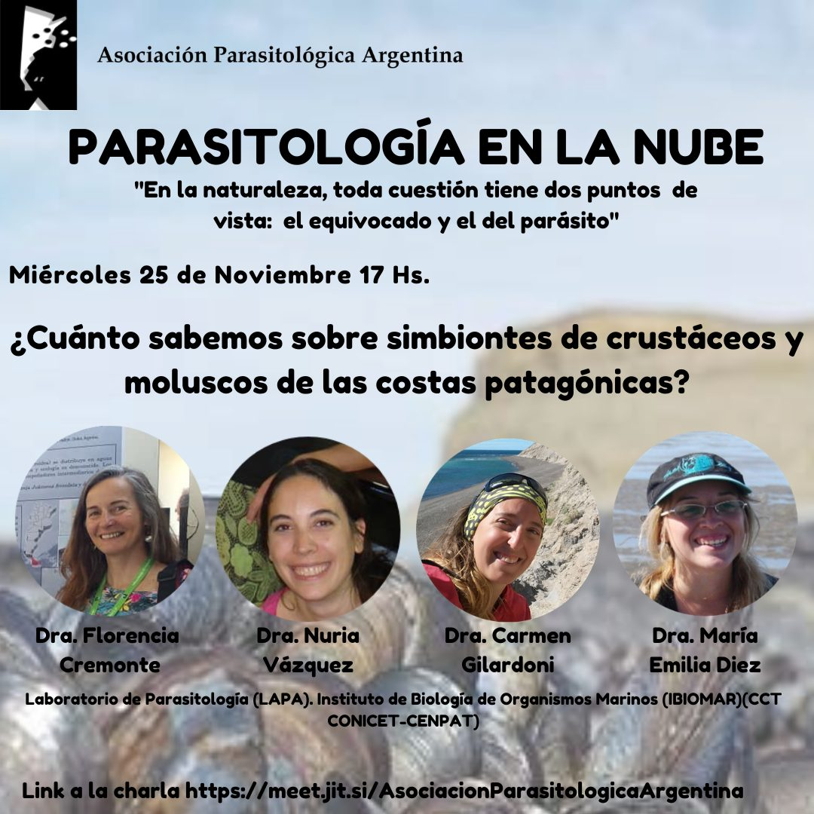

El ciclo **Parasitología en la Nube** de la APA continúa el **miércoles 25 de noviembre a las 17 h** con la charla **«¿Cuánto sabemos sobre simbiontes de crustáceos y moluscos de las costas patagónicas?»**.

Las expositoras serán las **Dras. Florencia Cremonte, Nuria Vázquez, Carmen Gilardoni y María Emilia Diez**, del Laboratorio de Parasitología (LAPA) del Instituto de Biología de Organismos Marinos (IBIOMAR, CCT CONICET-CENPAT).

Podés ver la charla aquí:


