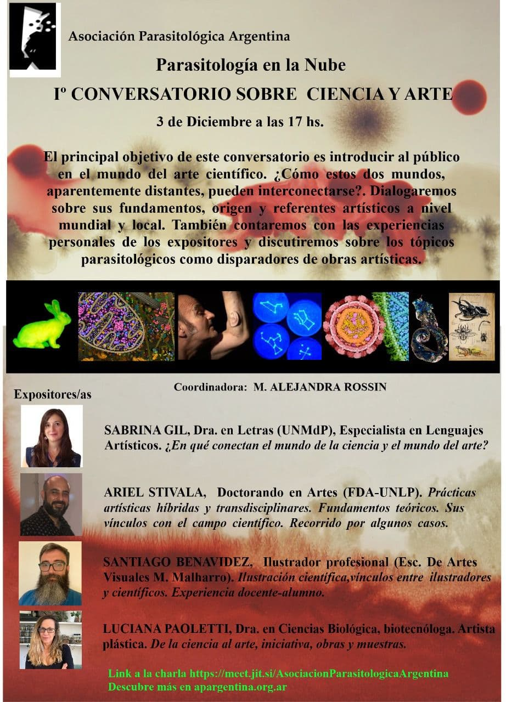

¿Cómo pueden conectarse dos mundos que parecen tan lejanos como la ciencia y el arte? Esa es la pregunta que guía el **I Conversatorio sobre Ciencia y Arte**, que la APA organiza dentro del ciclo **Parasitología en la Nube** el **jueves 3 de diciembre a las 17 h**.

El encuentro busca acercar al público al mundo del arte científico: sus fundamentos, su origen y sus referentes a nivel mundial y local. Además, los expositores compartirán sus experiencias personales y se discutirá cómo los temas parasitológicos pueden convertirse en disparadores de obras artísticas.

## Expositores

- **Sabrina Gil**, doctora en Letras (UNMdP) y especialista en lenguajes artísticos: «¿En qué conectan el mundo de la ciencia y el mundo del arte?».
- **Ariel Stivala**, doctorando en Artes (FDA-UNLP): prácticas artísticas híbridas y transdisciplinares y sus vínculos con el campo científico.
- **Santiago Benavídez**, ilustrador profesional (Escuela de Artes Visuales M. Malharro): ilustración científica y vínculos entre ilustradores y científicos.
- **Luciana Paoletti**, doctora en Ciencias Biológicas, biotecnóloga y artista plástica: de la ciencia al arte, iniciativas, obras y muestras.

**Coordina:** M. Alejandra Rossin.

La actividad es abierta y en línea. [Ingresá al conversatorio aquí](https://meet.jit.si/AsociacionParasitologicaArgentina)
