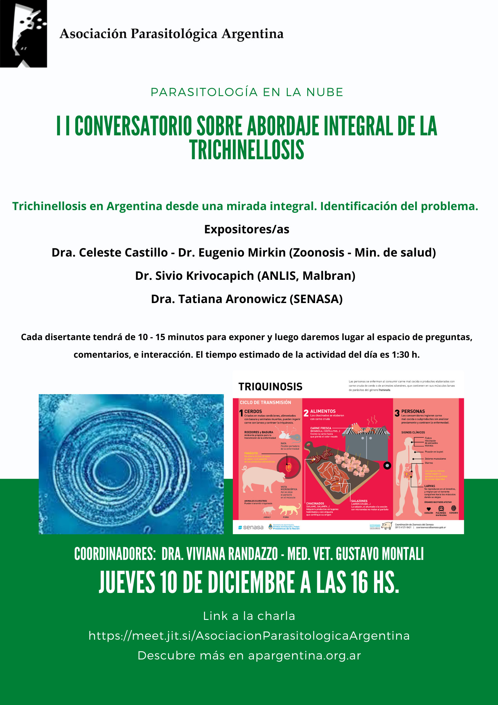

Continúa el ciclo de conversatorios de la APA sobre el abordaje integral de la trichinellosis. El **II Conversatorio**, «Trichinellosis en Argentina desde una mirada integral. Identificación del problema», será el **jueves 10 de diciembre a las 16 h**.

## Expositores

- **Dra. Celeste Castillo y Dr. Eugenio Mirkin**, Zoonosis, Ministerio de Salud de la Nación.
- **Dr. Silvio Krivokapich**, ANLIS «Dr. Carlos G. Malbrán».
- **Dra. Tatiana Aronowicz**, SENASA.

Cada disertante tendrá entre 10 y 15 minutos para exponer, y luego se abrirá un espacio de preguntas, comentarios e intercambio. La actividad dura alrededor de una hora y media.

**Coordinan:** Dra. Viviana Randazzo y MV Gustavo Montali.

[Ingresá al conversatorio aquí](https://meet.jit.si/AsociacionParasitologicaArgentina)
