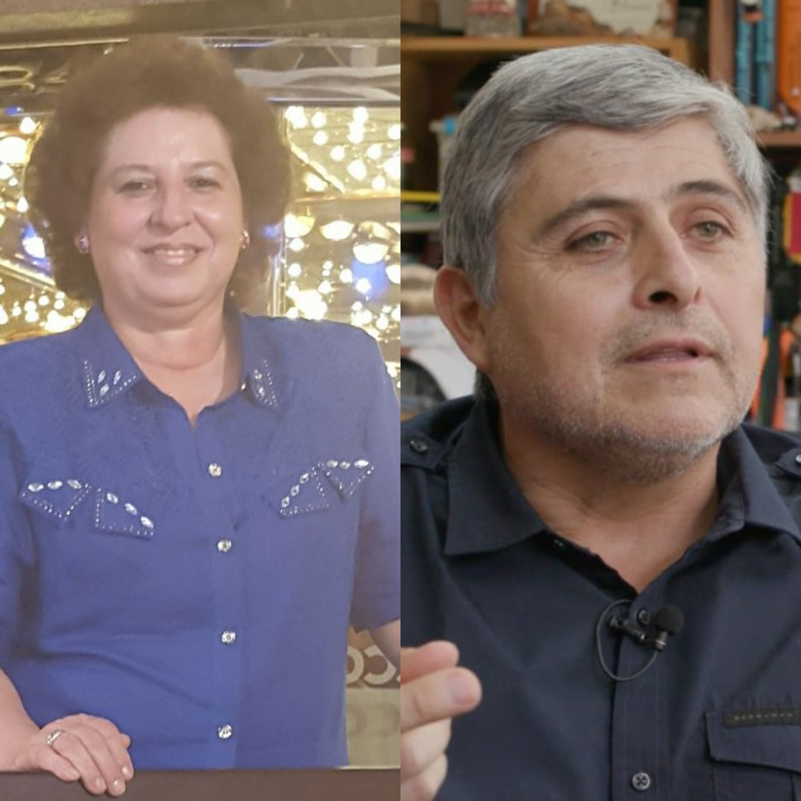

La Asociación Parasitológica Argentina comunica con profundo dolor el fallecimiento de dos reconocidos parasitólogos de la región.

La **Dra. Analía Autino** fue investigadora y docente de la Facultad de Ciencias Naturales e Instituto Miguel Lillo de la **Universidad Nacional de Tucumán**.

El **Dr. Daniel González Acuña** fue investigador y docente de la Facultad de Ciencias Veterinarias de la **Universidad de Concepción, Chile**.

Sus investigaciones contribuyeron de manera significativa al desarrollo de la parasitología latinoamericana.

Enviamos nuestro más sincero pésame a sus familias, amistades, colegas y discípulos.
