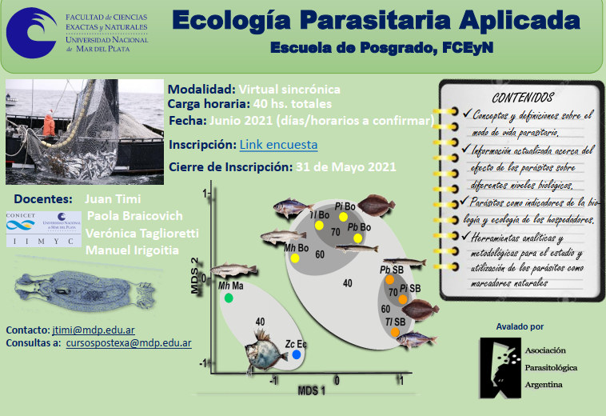

La Escuela de Posgrado de la Facultad de Ciencias Exactas y Naturales de la **Universidad Nacional de Mar del Plata** dictará en **junio de 2021** el curso de posgrado **«Ecología Parasitaria Aplicada»**, en modalidad **virtual sincrónica y gratuita**. El curso cuenta con el **aval de la APA**.

¿Pueden los parásitos contarnos de dónde viene un pez o cómo vive? El curso muestra cómo los parásitos funcionan como verdaderos indicadores de la biología y la ecología de sus hospedadores.

## Contenidos

- Conceptos y definiciones sobre el modo de vida parasitario.
- Información actualizada sobre el efecto de los parásitos en distintos niveles biológicos.
- Los parásitos como indicadores de la biología y la ecología de los hospedadores.
- Herramientas analíticas y metodológicas para usar los parásitos como marcadores naturales.

## Datos del curso

- **Docentes:** Dr. Juan Timi (CONICET-UNMdP), Dra. Paola Braicovich (CONICET), Dra. Verónica Taglioretti (CONICET) y Dr. Manuel Irigoitia (CONICET-UNMdP).
- **Carga horaria:** 40 horas.
- **Cierre de inscripción:** 31 de mayo de 2021.
- **Contacto:** jtimi@mdp.edu.ar. **Consultas:** cursospostexa@mdp.edu.ar

[Información del curso e inscripción aquí](/assets/docs/curso-ecologia-parasitaria-2021.pdf)
