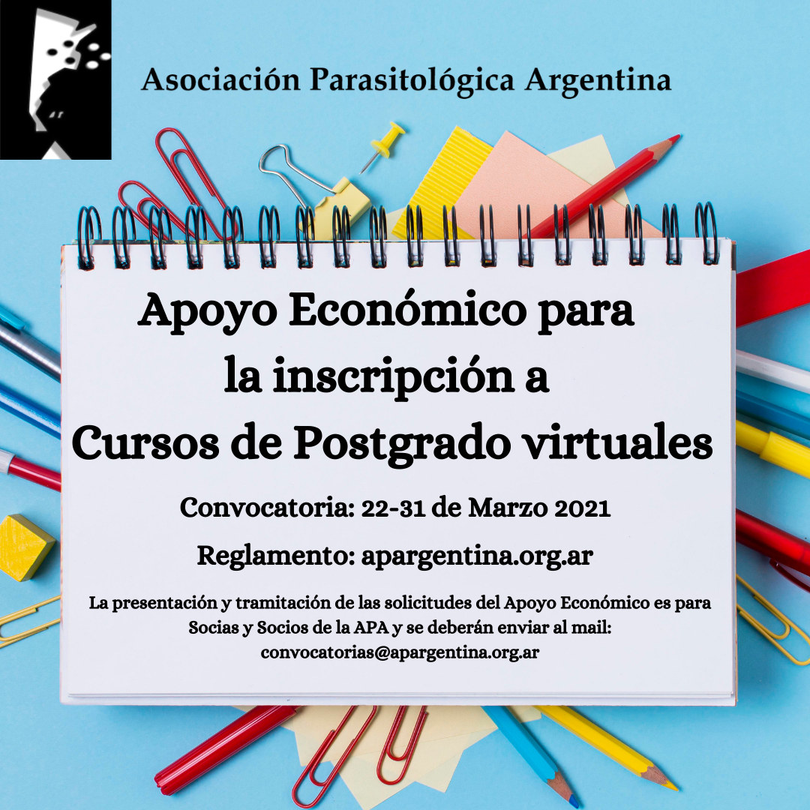

La **Asociación Parasitológica Argentina** abre una nueva convocatoria de **apoyo económico para la asistencia a cursos de posgrado virtuales**.

En esta oportunidad se otorgarán **cuatro apoyos económicos**, que podrán destinarse al pago de la inscripción a cursos de posgrado virtuales y a materiales de librería.

**Período de inscripción: del 22 al 31 de marzo de 2021.**

Los informes, la presentación y la tramitación de las solicitudes se realizan por correo a convocatorias@apargentina.org.ar

[Consultá el reglamento de la convocatoria aquí](https://apargentina.org.ar/convocatorias/apoyo-economico-cursos-de-postgrado/)
