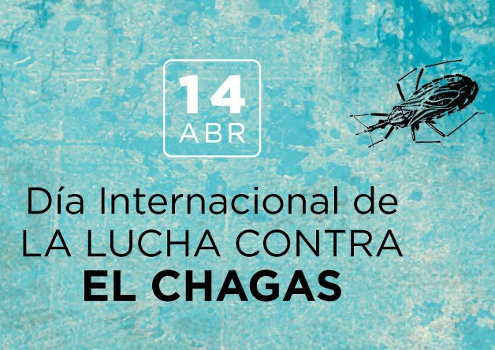

Cada **14 de abril** se conmemora el **Día Mundial de la Enfermedad de Chagas**. La fecha fue establecida por la **72.ª Asamblea Mundial de la Salud**, reunida en Ginebra el 24 de mayo de 2019.

¿Por qué el 14 de abril? Porque ese día, en 1909, el médico brasileño **Carlos Chagas** realizó el primer diagnóstico de la enfermedad que lleva su nombre, en **Berenice Soares**, una niña de dos años.

Más de un siglo después, el Chagas sigue siendo un problema de salud pública en América Latina, y la fecha es una oportunidad para darle visibilidad.

[Leé la nota completa del Bioq. Sergio Bontti aquí](https://um.edu.ar/14-de-abril-dia-mundial-de-la-enfermedad-de-chagas/)
