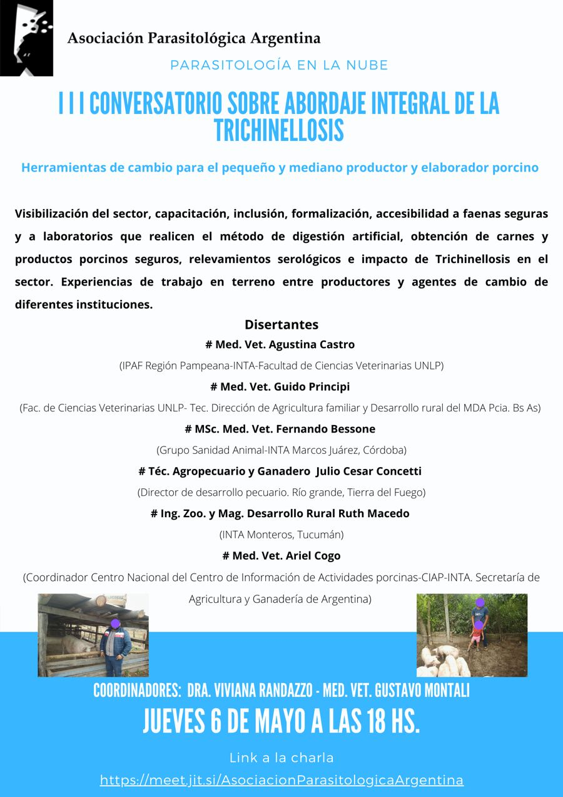

El ciclo de conversatorios de la APA sobre el abordaje integral de la trichinellosis continúa con el **III Conversatorio**, «Herramientas de cambio para el pequeño y mediano productor y elaborador porcino», el **jueves 6 de mayo de 2021 a las 18 h**.

El encuentro abordará la visibilización del sector, la capacitación, la inclusión y la formalización; el acceso a faenas seguras y a laboratorios que realicen el método de digestión artificial; la obtención de carnes y productos porcinos seguros; los relevamientos serológicos y el impacto de la trichinellosis en el sector. También se compartirán experiencias de trabajo en terreno entre productores y agentes de cambio de distintas instituciones.

## Disertantes

- **MV Agustina Castro**, IPAF Región Pampeana (INTA) y Facultad de Ciencias Veterinarias (UNLP).
- **MV Guido Principi**, Facultad de Ciencias Veterinarias (UNLP) y técnico de la Dirección de Agricultura Familiar y Desarrollo Rural del Ministerio de Desarrollo Agrario de la provincia de Buenos Aires.
- **MSc. MV Fernando Bessone**, Grupo Sanidad Animal, INTA Marcos Juárez (Córdoba).
- **Téc. Agropecuario y Ganadero Julio César Concetti**, director de Desarrollo Pecuario de Río Grande (Tierra del Fuego).
- **Ing. Zoot. y Mag. en Desarrollo Rural Ruth Macedo**, INTA Monteros (Tucumán).
- **MV Ariel Cogo**, coordinador del Centro de Información de Actividades Porcinas (CIAP-INTA), Secretaría de Agricultura y Ganadería de la Nación.

**Coordinan:** Dra. Viviana Randazzo y MV Gustavo Montali.

Podés ver el video del conversatorio aquí:


