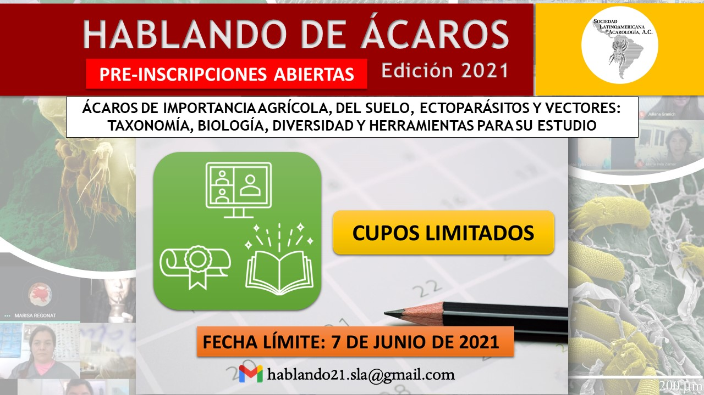

La **Sociedad Latinoamericana de Acarología (SLA)**, con la colaboración de referentes internacionales, presenta la edición 2021 de **«Hablando de ácaros»**, un curso virtual sobre **ácaros de importancia agrícola, del suelo, ectoparásitos y vectores: taxonomía, biología, diversidad y herramientas para su estudio**.

## Datos del curso

- **Fechas:** del 12 de julio al 18 de septiembre de 2021, los martes, jueves y sábados.
- **Modalidad:** virtual.
- **Destinatarios:** profesionales y estudiantes de grado y posgrado de Ciencias Biológicas, Agronomía, Veterinaria, Ciencias Ambientales y carreras afines.
- **Cupos limitados.** La preinscripción cierra el **7 de junio de 2021**.
- **Contacto:** hablando21.sla@gmail.com
