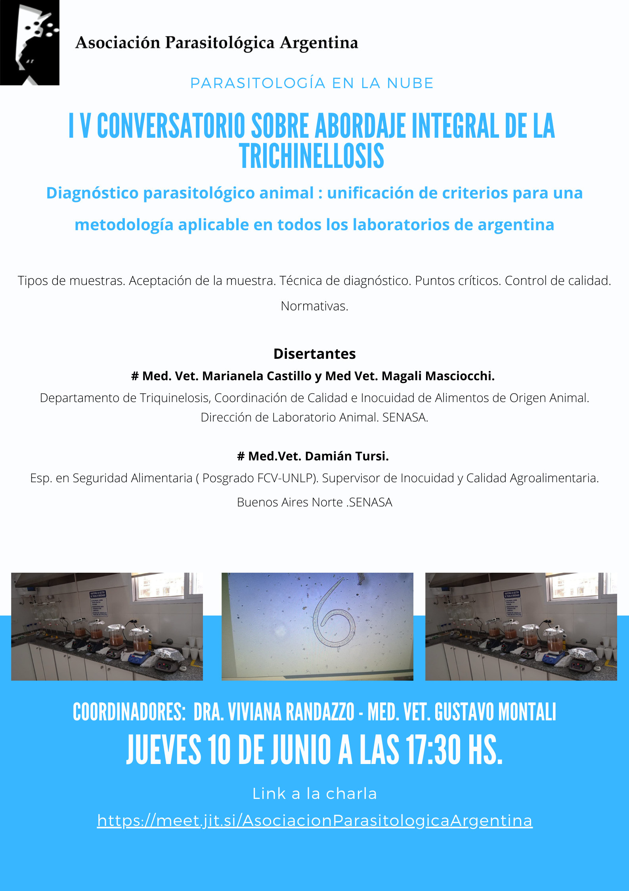

El ciclo de conversatorios de la APA sobre el abordaje integral de la trichinellosis llega a su cuarta edición con un tema clave: **«Diagnóstico parasitológico animal: unificación de criterios para una metodología aplicable en todos los laboratorios de Argentina»**.

El encuentro será el **jueves 10 de junio de 2021 a las 17:30 h** y abordará los tipos de muestras y su aceptación, la técnica de diagnóstico, los puntos críticos, el control de calidad y las normativas vigentes.

## Disertantes

- **MV Marianela Castillo y MV Magalí Masciocchi**, Departamento de Triquinelosis, Coordinación de Calidad e Inocuidad de Alimentos de Origen Animal, Dirección de Laboratorio Animal, SENASA.
- **MV Damián Tursi**, especialista en Seguridad Alimentaria (FCV-UNLP) y supervisor de Inocuidad y Calidad Agroalimentaria, SENASA Buenos Aires Norte.

**Coordinan:** Dra. Viviana Randazzo y MV Gustavo Montali.

[Ingresá al conversatorio aquí](https://meet.jit.si/AsociacionParasitologicaArgentina)
