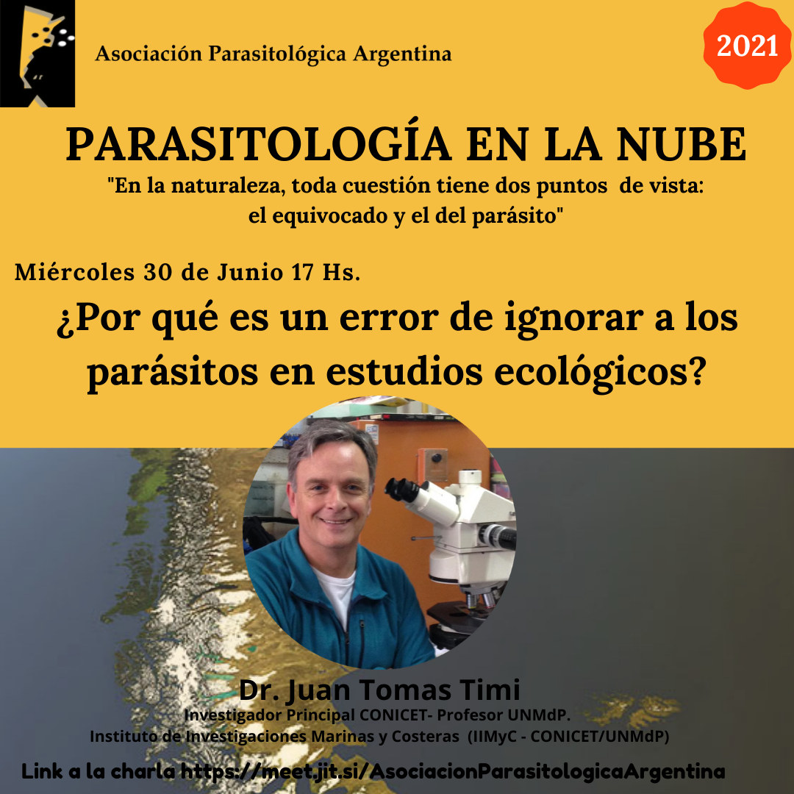

El ciclo de charlas **Parasitología en la Nube** vuelve en 2021, y la primera cita es con una pregunta provocadora: **«¿Por qué es un error ignorar a los parásitos en estudios ecológicos?»**.

La charla será el **miércoles 30 de junio a las 17 h**, a cargo del **Dr. Juan Tomás Timi**, investigador principal del CONICET, profesor de la UNMdP y miembro del Instituto de Investigaciones Marinas y Costeras (IIMyC, CONICET-UNMdP).

La actividad es abierta y en línea. [Ingresá a la charla aquí](https://meet.jit.si/AsociacionParasitologicaArgentina)
