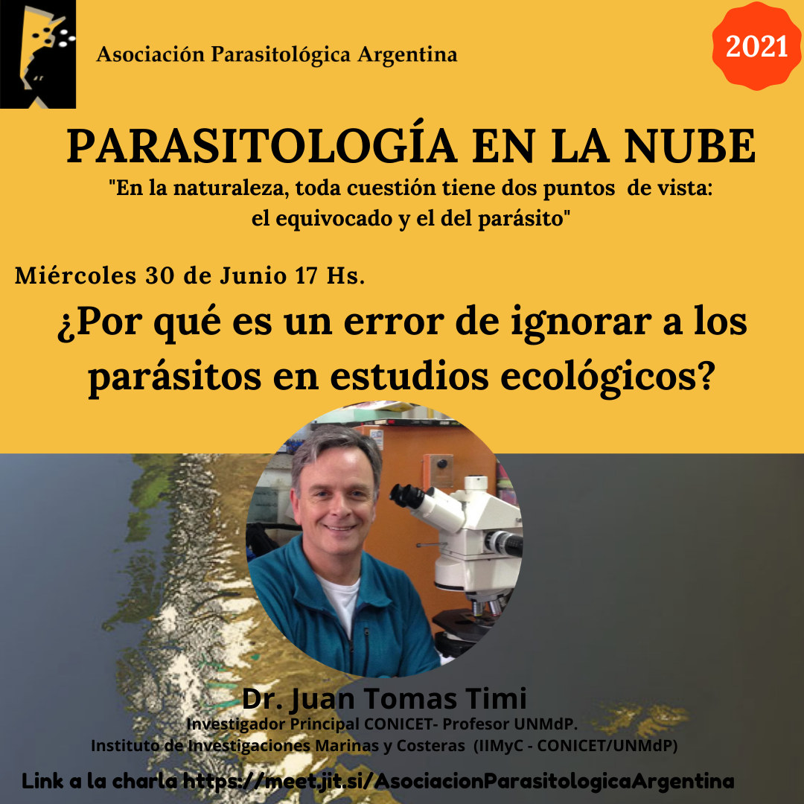

El ciclo **Parasitología en la Nube** de la APA continúa el **miércoles 30 de junio a las 17 h** con la charla **«¿Por qué es un error ignorar a los parásitos en estudios ecológicos?»**.

El expositor será el **Dr. Juan Tomás Timi**, investigador principal del CONICET, profesor de la UNMdP e integrante del Instituto de Investigaciones Marinas y Costeras (IIMyC, CONICET-UNMdP).

Podés ver la charla aquí:


