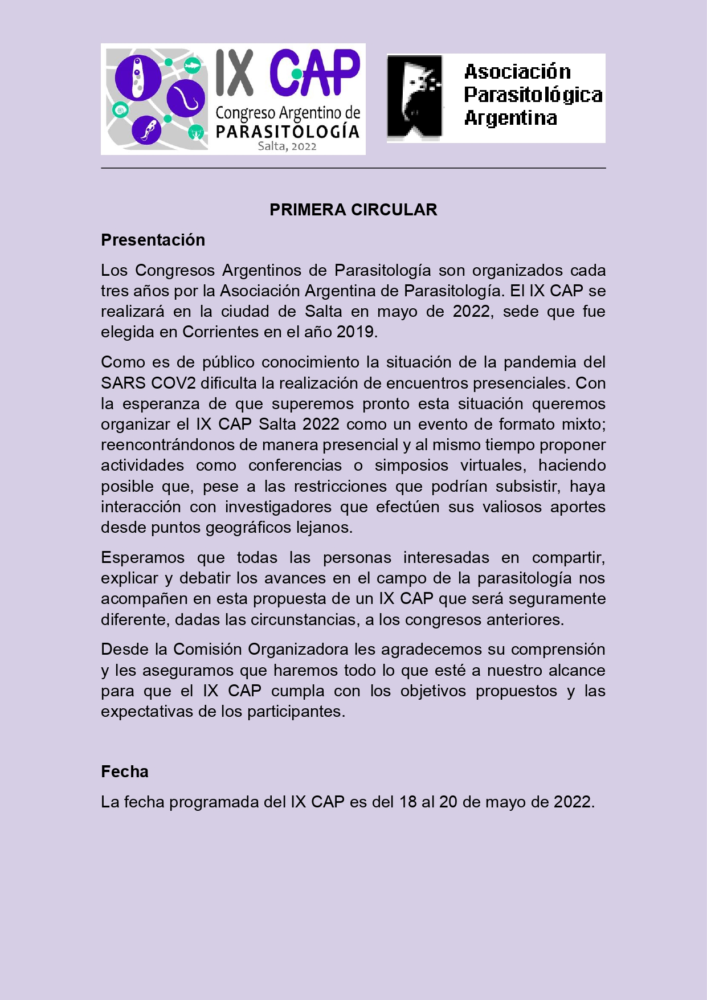
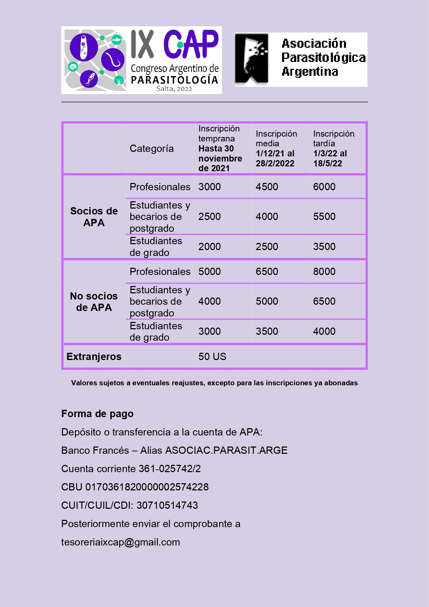

La Asociación Parasitológica Argentina presenta la **primera circular del IX Congreso Argentino de Parasitología (IX CAP)**, que se realizará del **18 al 20 de mayo de 2022 en la ciudad de Salta**. Será la **primera vez que el Congreso se celebre en el noroeste argentino**. La sede fue elegida durante el congreso de Corrientes, en 2019.

Los Congresos Argentinos de Parasitología se realizan cada tres años. Ante la incertidumbre por la pandemia, el IX CAP se organiza en **formato mixto**: encuentros presenciales y, al mismo tiempo, conferencias y simposios virtuales que permitan sumar a investigadores de lugares lejanos.

## «Parásitos en red»

Ese es el lema del IX CAP. Los parásitos forman redes intrincadas en los ecosistemas, en las que distintas especies, estadios y hospedadores se entrecruzan. Del mismo modo, las y los parasitólogos trabajan en red, estudiando con enfoques complementarios los parásitos y sus vínculos con hospedadores y ambiente. El logo, diseñado por la Dra. Ivanna Gabriela Cruz, representa justamente esa red.

## Áreas temáticas

Biodiversidad y biogeografía; fisiología de parásitos y hospedadores; ecología parasitaria y epidemiología; diagnóstico, inmunología, patología y control; fitoparasitología; paleoparasitología; parasitología experimental, humana y animal; parasitología de cromistas y protozoos; parasitología molecular; parásitos y sociedad; taxonomía, sistemática y filogenia; y temas abiertos.

## Fechas importantes

- **Propuestas de simposios, talleres o minicursos:** hasta el 30 de septiembre de 2021.
- **Envío de resúmenes:** hasta el 4 de marzo de 2022. Se pueden presentar hasta dos resúmenes como primer autor, y al menos un coautor debe estar inscripto.

El congreso incluirá conferencias, simposios, pósters, comunicaciones orales, talleres y minicursos precongreso.

## Aranceles de inscripción

| Categoría | Hasta 30/11/2021 | 1/12/2021 al 28/2/2022 | 1/3 al 18/5/2022 |
|---|---|---|---|
| Socios APA – Profesionales | $3.000 | $4.500 | $6.000 |
| Socios APA – Estudiantes y becarios de posgrado | $2.500 | $4.000 | $5.500 |
| Socios APA – Estudiantes de grado | $2.000 | $2.500 | $3.500 |
| No socios – Profesionales | $5.000 | $6.500 | $8.000 |
| No socios – Estudiantes y becarios de posgrado | $4.000 | $5.000 | $6.500 |
| No socios – Estudiantes de grado | $3.000 | $3.500 | $4.000 |
| Extranjeros | USD 50 | | |

Los socios de la APA deben tener la cuota al día. Gracias al convenio entre ambas asociaciones, **los socios de la Sociedad Argentina de Protozoología pagan lo mismo que los socios de la APA**. Los valores pueden sufrir reajustes, salvo para las inscripciones ya abonadas.

El pago se realiza por depósito o transferencia a la cuenta de la APA, y el comprobante se envía a tesoreriaixcap@gmail.com

## Comisión Organizadora

Presidenta honoraria: Margarita Ostrowski de Núñez. Presidenta: Dora Davies. Gestión académica: Carolina Davies y Virginia Martínez. Coordinación: Regina Párraga. Gestión económica: Florencia Liquin. Difusión: Lorena Ailán Choke. Vocales: Rubén Cardozo, Gabriela Chauque, Juan José Lauthier, Verónica Olivo y Paula Ragone.
