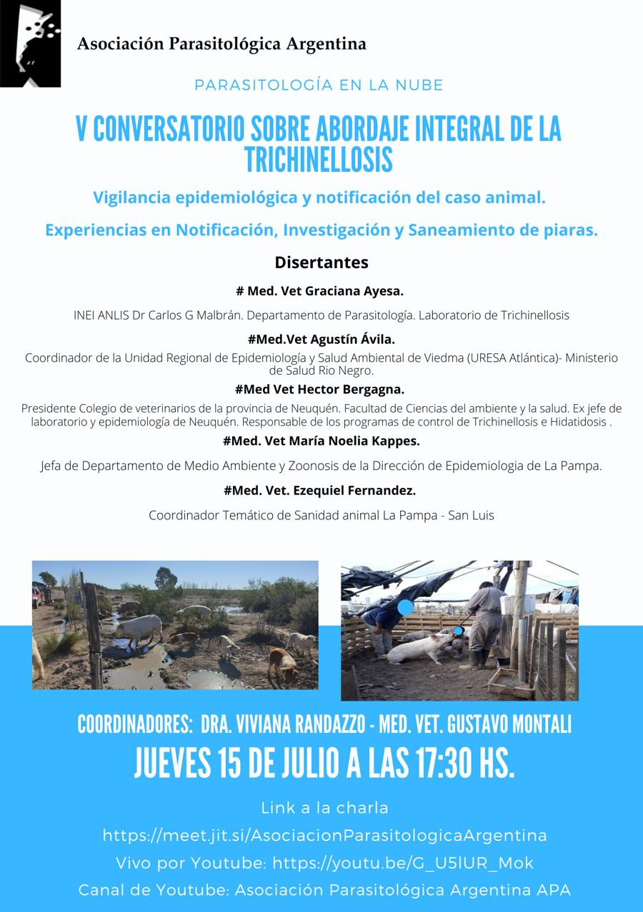

El **V Conversatorio sobre abordaje integral de la trichinellosis** estará dedicado a la **«Vigilancia epidemiológica y notificación del caso animal. Experiencias en notificación, investigación y saneamiento de piaras»**.

El encuentro será el **jueves 15 de julio de 2021 a las 17:30 h**, con transmisión en vivo también por el canal de YouTube de la APA.

## Disertantes

- **MV Graciana Ayesa**, Laboratorio de Trichinellosis, Departamento de Parasitología, INEI-ANLIS «Dr. Carlos G. Malbrán».
- **MV Agustín Ávila**, coordinador de la Unidad Regional de Epidemiología y Salud Ambiental de Viedma (URESA Atlántica), Ministerio de Salud de Río Negro.
- **MV Héctor Bergagna**, presidente del Colegio de Veterinarios de la provincia de Neuquén, Facultad de Ciencias del Ambiente y la Salud. Fue jefe de Laboratorio y Epidemiología de Neuquén y es responsable de los programas de control de trichinellosis e hidatidosis.
- **MV María Noelia Kappes**, jefa del Departamento de Medio Ambiente y Zoonosis de la Dirección de Epidemiología de La Pampa.
- **MV Ezequiel Fernández**, coordinador temático de Sanidad Animal La Pampa-San Luis.

**Coordinan:** Dra. Viviana Randazzo y MV Gustavo Montali.

Podés ver el video del conversatorio aquí:



Por problemas en la grabación, el video quedó cortado. Las presentaciones de tres de los disertantes están disponibles en PDF: [Graciana Ayesa](/assets/docs/conversatorio-v-trichinellosis-ayesa.pdf), [Agustín Ávila](/assets/docs/conversatorio-v-trichinellosis-avila.pdf) y [Héctor Bergagna](/assets/docs/conversatorio-v-trichinellosis-bergagna.pdf).
