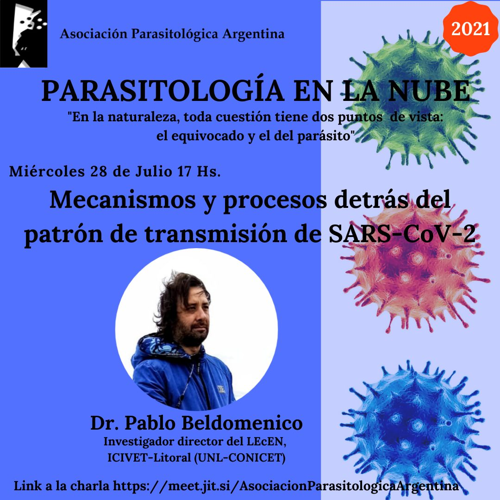

El ciclo **Parasitología en la Nube** de la APA continúa el **miércoles 28 de julio a las 17 h** con la charla **«Mecanismos y procesos detrás del patrón de transmisión de SARS-CoV-2»**.

El expositor será el **Dr. Pablo Beldomenico**, investigador y director del Laboratorio de Ecología de Enfermedades (LEcEN) del ICIVET-Litoral (UNL-CONICET).

Podés ver la charla aquí:


