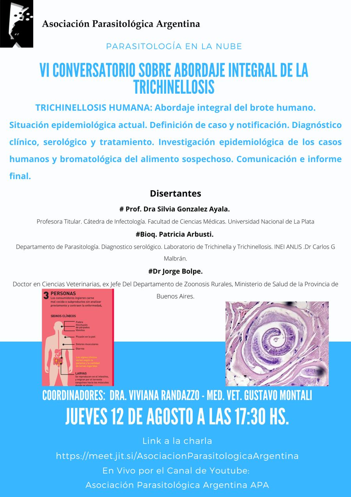

El **VI Conversatorio sobre abordaje integral de la trichinellosis** pone el foco en la **trichinellosis humana** y en cómo abordar un brote de manera integral.

El encuentro será el **jueves 12 de agosto de 2021 a las 17:30 h**, con transmisión en vivo también por el canal de YouTube de la APA.

## Temas

- Abordaje integral del brote humano y situación epidemiológica actual.
- Definición de caso y notificación.
- Diagnóstico clínico, serológico y tratamiento.
- Investigación epidemiológica de los casos humanos y bromatológica del alimento sospechoso.
- Comunicación e informe final.

## Disertantes

- **Prof. Dra. Silvia González Ayala**, profesora titular de la Cátedra de Infectología, Facultad de Ciencias Médicas, Universidad Nacional de La Plata.
- **Bioq. Patricia Arbusti**, diagnóstico serológico, Laboratorio de *Trichinella* y Trichinellosis, Departamento de Parasitología, INEI-ANLIS «Dr. Carlos G. Malbrán».
- **Dr. Jorge Bolpe**, doctor en Ciencias Veterinarias y exjefe del Departamento de Zoonosis Rurales del Ministerio de Salud de la provincia de Buenos Aires.

**Coordinan:** Dra. Viviana Randazzo y MV Gustavo Montali.

Podés ver el video del conversatorio aquí:


