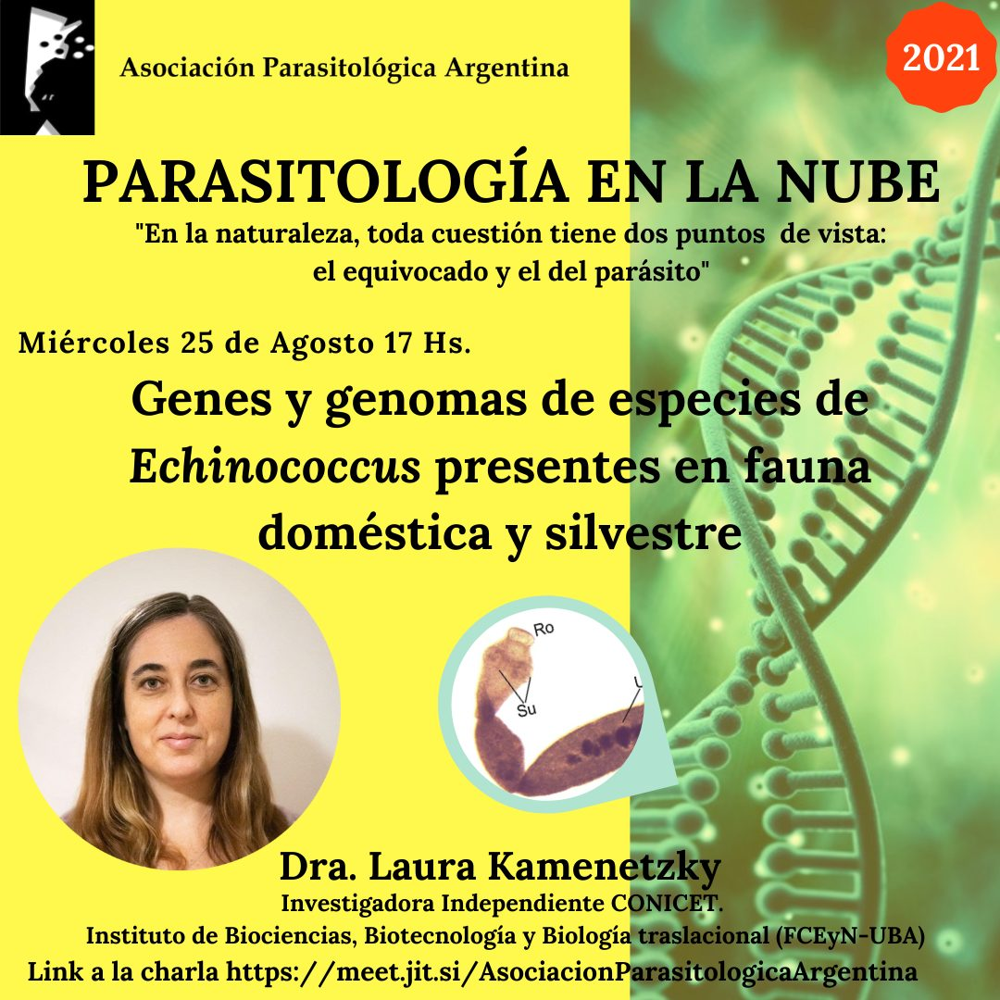

El ciclo **Parasitología en la Nube** de la APA continúa el **miércoles 25 de agosto a las 17 h** con la charla **«Genes y genomas de especies de *Echinococcus* presentes en fauna doméstica y silvestre»**.

La expositora será la **Dra. Laura Kamenetzky**, investigadora independiente del CONICET en el Instituto de Biociencias, Biotecnología y Biología Traslacional (FCEyN-UBA).

Podés ver la charla aquí:


