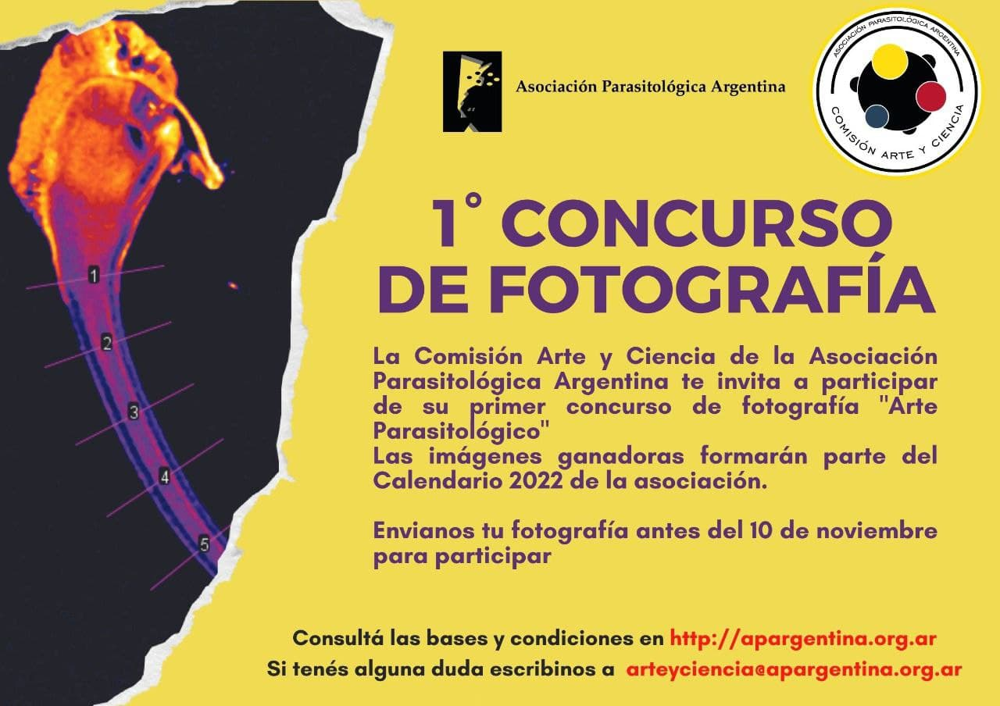

¿Tenés una imagen de un parásito que podría ser una obra de arte? La **Comisión Arte y Ciencia de la Asociación Parasitológica Argentina** invita a participar del **1.º Concurso de Fotografía «Arte Parasitológico»**.

**Las imágenes ganadoras formarán parte del Calendario 2022 de la APA.**

Las fotografías se reciben **hasta el 10 de noviembre de 2021**.

[Consultá las bases y condiciones del concurso aquí](https://apargentina.org.ar/1-concurso-de-fotografia/)

¿Dudas? Escribí a arteyciencia@apargentina.org.ar
