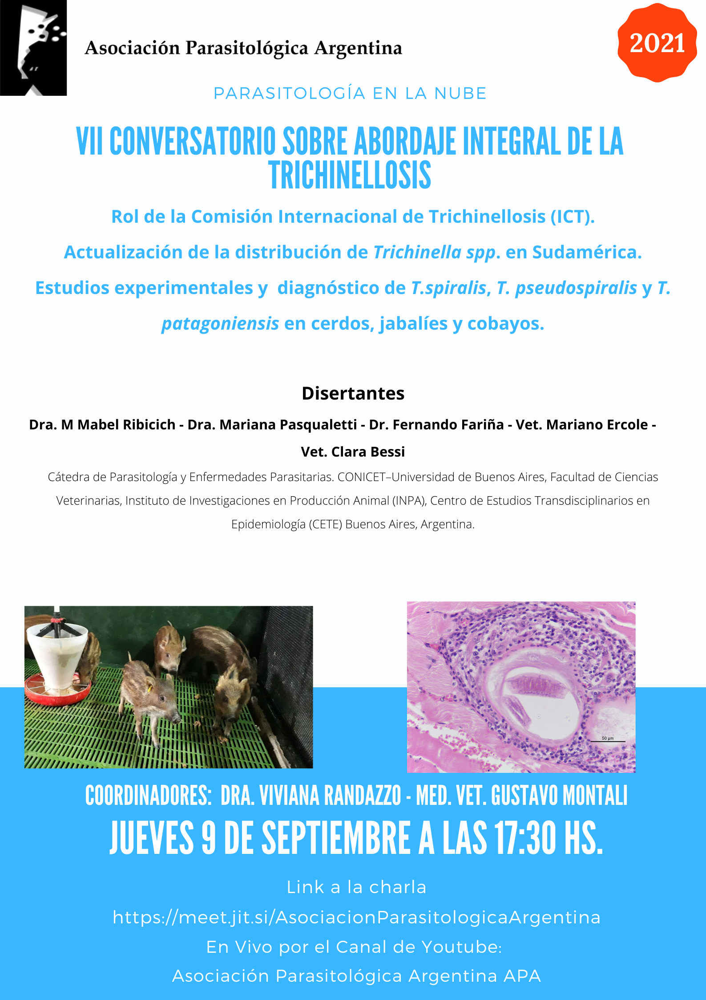

El ciclo de conversatorios de la APA sobre el abordaje integral de la trichinellosis presenta su **séptima edición** el **jueves 9 de septiembre de 2021 a las 17:30 h**, con transmisión en vivo también por el canal de YouTube de la Asociación.

## Temas

- El rol de la **Comisión Internacional de Trichinellosis (ICT)**.
- Actualización de la distribución de *Trichinella* spp. en Sudamérica.
- Estudios experimentales y diagnóstico de *T. spiralis*, *T. pseudospiralis* y *T. patagoniensis* en cerdos, jabalíes y cobayos.

## Disertantes

Dra. M. Mabel Ribicich, Dra. Mariana Pasqualetti, Dr. Fernando Fariña, Vet. Mariano Ercole y Vet. Clara Bessi, de la Cátedra de Parasitología y Enfermedades Parasitarias de la Facultad de Ciencias Veterinarias (UBA-CONICET, INPA y CETE).

**Coordinan:** Dra. Viviana Randazzo y MV Gustavo Montali.

[Ingresá al conversatorio aquí](https://meet.jit.si/AsociacionParasitologicaArgentina)
