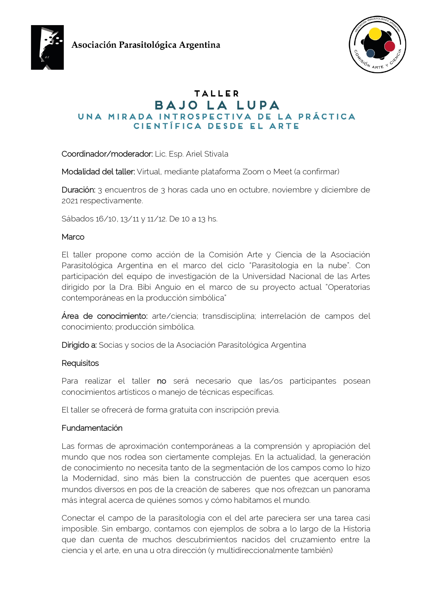

¿Qué pasa cuando una parasitóloga o un parasitólogo mira su objeto de estudio con ojos de artista? Esa es la invitación del taller **«Bajo la lupa: una mirada introspectiva de la práctica científica desde el arte»**, propuesto por la **Comisión Arte y Ciencia de la APA** en el marco del ciclo Parasitología en la Nube.

El taller cuenta con la participación del equipo de investigación de la Universidad Nacional de las Artes dirigido por la Dra. Bibi Anguio. Lo coordina el **Lic. Esp. Ariel Stivala**, profesor y licenciado en Artes Plásticas (FDA-UNLP), doctorando en Artes e integrante de la Comisión Arte y Ciencia.

## Qué propone el taller

- Introducir los debates sobre los vínculos entre la práctica científica y la práctica artística.
- Reflexionar sobre la propia práctica profesional a partir de actividades lúdicas y sencillas.
- Crear una o más piezas poéticas a partir de los saberes de cada participante: sus objetos de estudio y sus formas de investigar.
- Abrir un espacio para explorar métodos propios del arte.

## Cronograma

1. **Sábado 16 de octubre:** los límites y cruces entre arte y ciencia, con foco en la parasitología. Ejercicios de transposición y sinestesia.
2. **Sábado 13 de noviembre:** introducción a las prácticas artísticas contemporáneas. Nuevos escenarios poéticos para el objeto de estudio.
3. **Sábado 11 de diciembre:** primeros pasos hacia un proyecto transdisciplinar.

Los encuentros son **virtuales, de 10 a 13 h**. El taller está dirigido a **socias y socios de la APA**, es **gratuito** y **no requiere conocimientos artísticos previos**. Es además un primer acercamiento a un taller más extenso de seguimiento de proyectos previsto para 2022.

**Inscripción:** enviá tu nombre y apellido a arteyciencia@apargentina.org.ar
