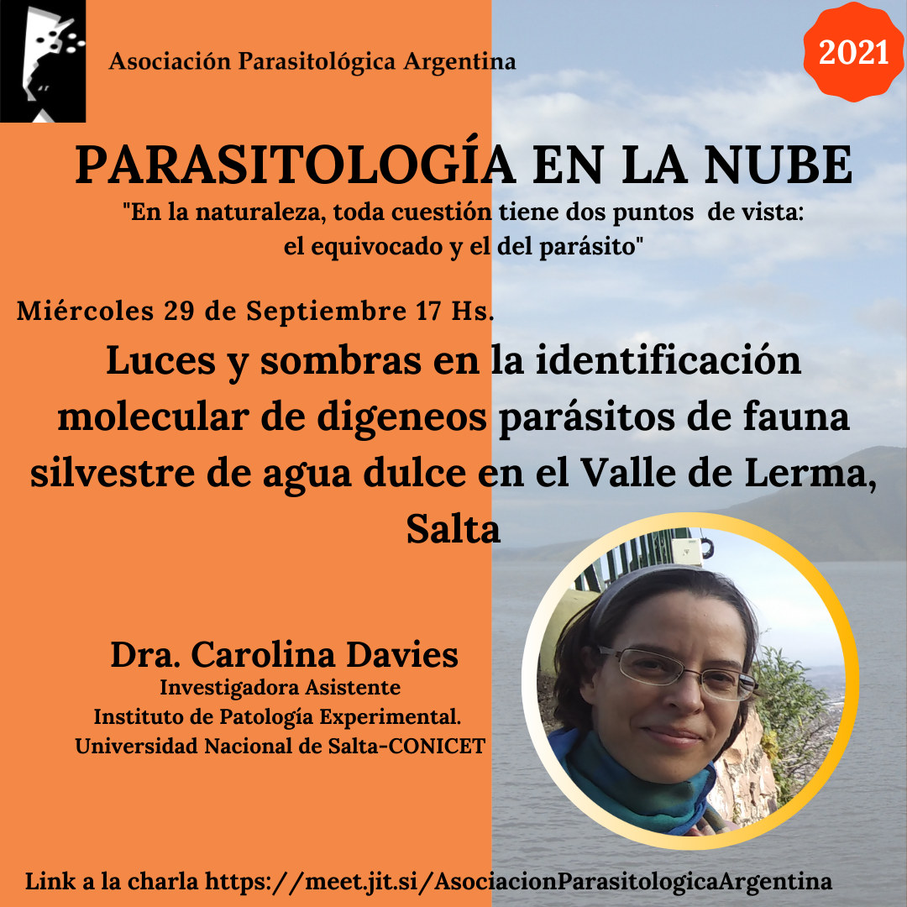

El ciclo **Parasitología en la Nube** presenta el **miércoles 29 de septiembre a las 17 h** la charla **«Luces y sombras en la identificación molecular de digeneos parásitos de fauna silvestre de agua dulce en el Valle de Lerma, Salta»**.

La expositora será la **Dra. Carolina Davies**, investigadora asistente del Instituto de Patología Experimental (Universidad Nacional de Salta-CONICET).

La actividad es abierta y en línea. [Ingresá a la charla aquí](https://meet.jit.si/AsociacionParasitologicaArgentina)
