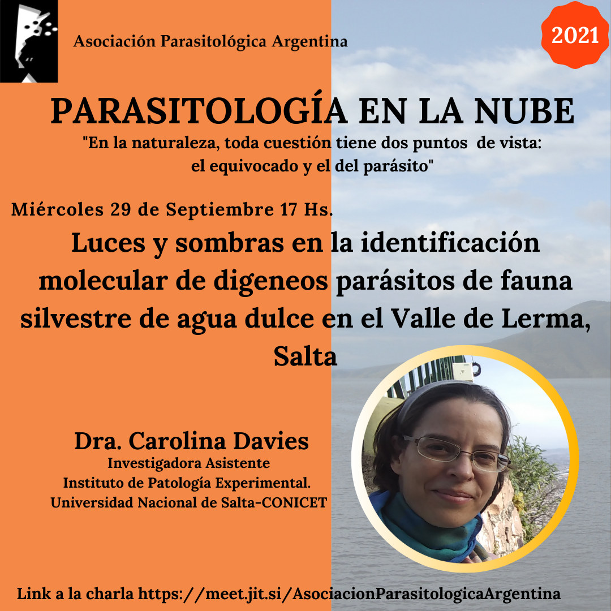

El ciclo **Parasitología en la Nube** de la APA continúa el **miércoles 29 de septiembre a las 17 h** con la charla **«Luces y sombras en la identificación molecular de digeneos parásitos de fauna silvestre de agua dulce en el Valle de Lerma, Salta»**.

La expositora será la **Dra. Carolina Davies**, investigadora asistente del Instituto de Patología Experimental (Universidad Nacional de Salta-CONICET).

Podés ver la charla aquí:


