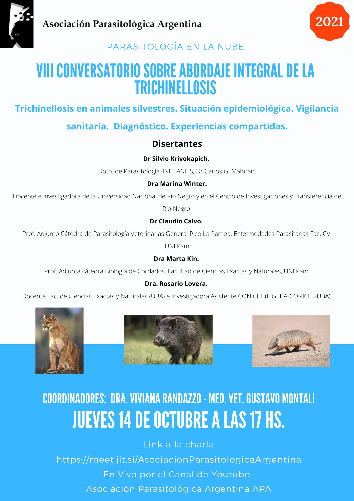

La trichinellosis no solo circula en cerdos domésticos: la fauna silvestre también cumple un papel en su transmisión. El **VIII Conversatorio sobre abordaje integral de la trichinellosis** se dedicará a la **trichinellosis en animales silvestres**: situación epidemiológica, vigilancia sanitaria, diagnóstico y experiencias compartidas.

El encuentro será el **jueves 14 de octubre de 2021 a las 17 h**, con transmisión en vivo también por el canal de YouTube de la APA.

## Disertantes

- **Dr. Silvio Krivokapich**, Departamento de Parasitología, INEI-ANLIS «Dr. Carlos G. Malbrán».
- **Dra. Marina Winter**, Universidad Nacional de Río Negro y Centro de Investigaciones y Transferencia de Río Negro.
- **Dr. Claudio Calvo**, Cátedra de Parasitología y Enfermedades Parasitarias, Facultad de Ciencias Veterinarias, UNLPam.
- **Dra. Marta Kin**, Cátedra de Biología de Cordados, Facultad de Ciencias Exactas y Naturales, UNLPam.
- **Dra. Rosario Lovera**, FCEN-UBA e IEGEBA (CONICET-UBA).

**Coordinan:** Dra. Viviana Randazzo y MV Gustavo Montali.

[Ingresá al conversatorio aquí](https://meet.jit.si/AsociacionParasitologicaArgentina) o seguilo en el [canal de YouTube de la APA](https://www.youtube.com/channel/UCLTP0LHsUAKsTvA5TDFFmFw).
