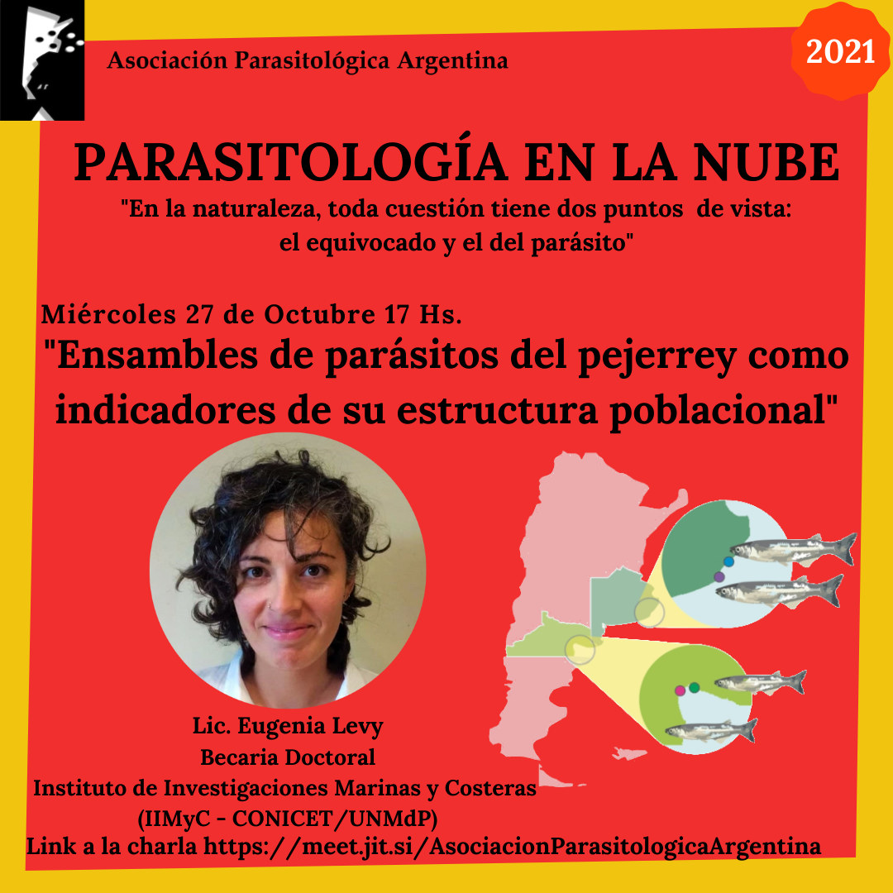

¿Pueden los parásitos ayudarnos a saber si dos grupos de peces pertenecen a la misma población? La **Lic. Eugenia Levy**, becaria doctoral del Instituto de Investigaciones Marinas y Costeras (IIMyC, CONICET-UNMdP), lo explicará en la charla **«Ensambles de parásitos del pejerrey como indicadores de su estructura poblacional»**.

La cita es el **miércoles 27 de octubre a las 17 h**, dentro del ciclo **Parasitología en la Nube**.

La actividad es abierta y en línea. [Ingresá a la charla aquí](https://meet.jit.si/AsociacionParasitologicaArgentina)
