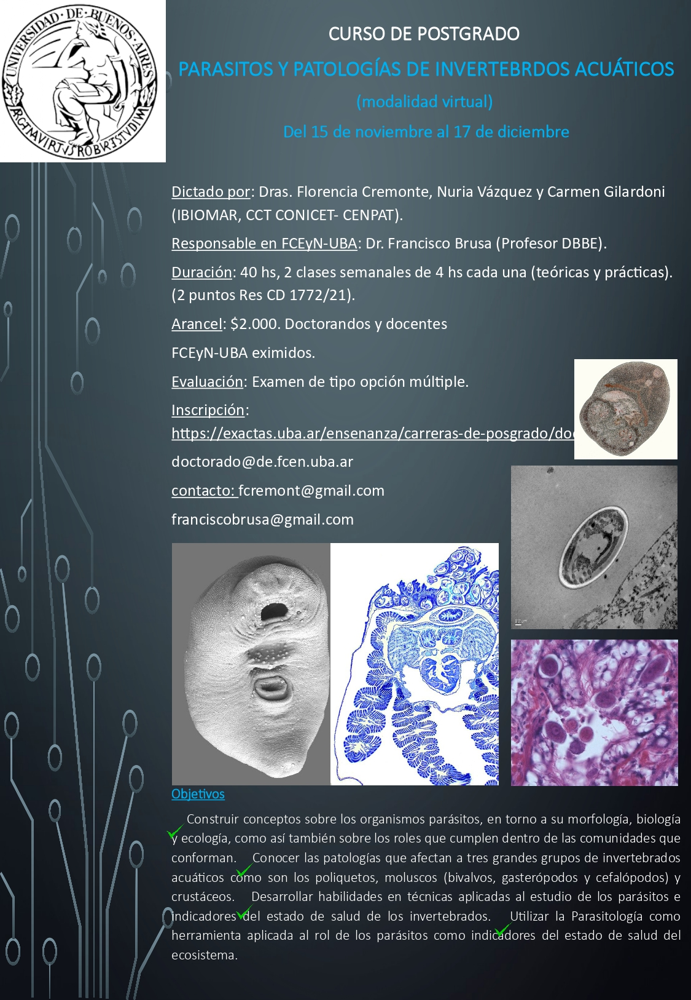

La Facultad de Ciencias Exactas y Naturales de la **UBA** ofrece el curso de posgrado virtual **«Parásitos y patologías de invertebrados acuáticos»**, del **15 de noviembre al 17 de diciembre de 2021**.

Lo dictan la **Dra. Florencia Cremonte**, la **Dra. Nuria Vázquez** y la **Dra. Carmen Gilardoni**, del IBIOMAR (CCT CONICET-CENPAT). El responsable en la FCEyN-UBA es el **Dr. Francisco Brusa** (DBBE).

## Qué se aprende

- Morfología, biología y ecología de los organismos parásitos y su rol en las comunidades.
- Patologías que afectan a tres grandes grupos de invertebrados acuáticos: poliquetos, moluscos (bivalvos, gasterópodos y cefalópodos) y crustáceos.
- Técnicas para estudiar parásitos e indicadores del estado de salud de los invertebrados.
- La parasitología como herramienta para evaluar la salud de los ecosistemas.

## Datos del curso

- **Duración:** 40 horas, con dos clases semanales de 4 horas (teóricas y prácticas). Otorga 2 puntos (Res. CD 1772/21).
- **Evaluación:** examen de opción múltiple.
- **Arancel:** $2.000. Doctorandos y docentes de la FCEyN-UBA están eximidos.
- **Inscripción:** a través de la [web de posgrado de Exactas-UBA](https://exactas.uba.ar/ensenanza/carreras-de-posgrado/doctorado/).
- **Contacto:** fcremont@gmail.com y franciscobrusa@gmail.com
