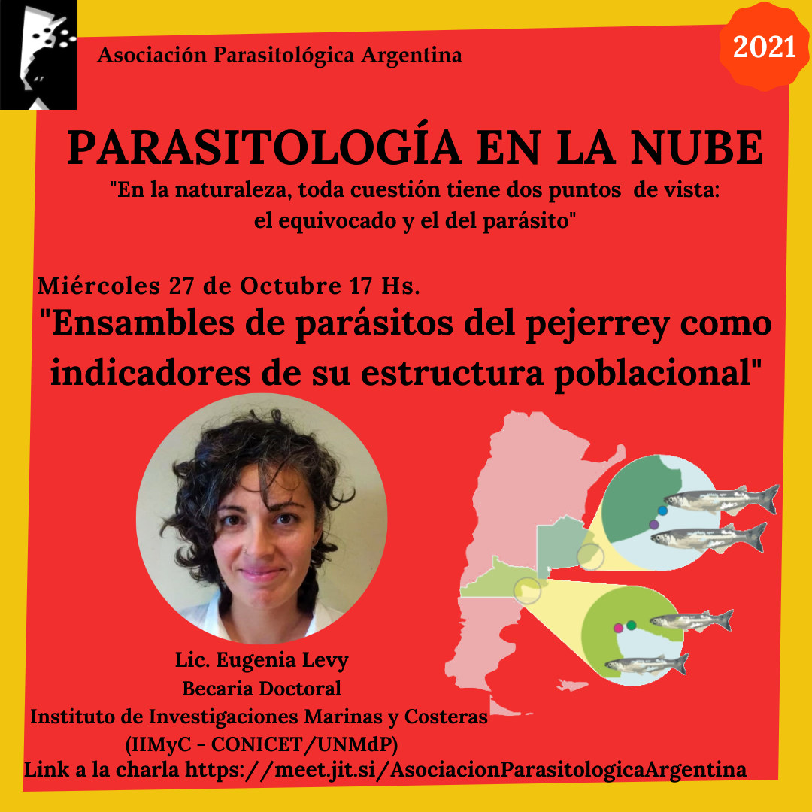

El ciclo **Parasitología en la Nube** de la APA continúa el **miércoles 27 de octubre a las 17 h** con la charla **«Ensambles de parásitos del pejerrey como indicadores de su estructura poblacional»**.

La expositora será la **Lic. Eugenia Levy**, becaria doctoral del Instituto de Investigaciones Marinas y Costeras (IIMyC, CONICET-UNMdP).

Podés ver la charla aquí:


