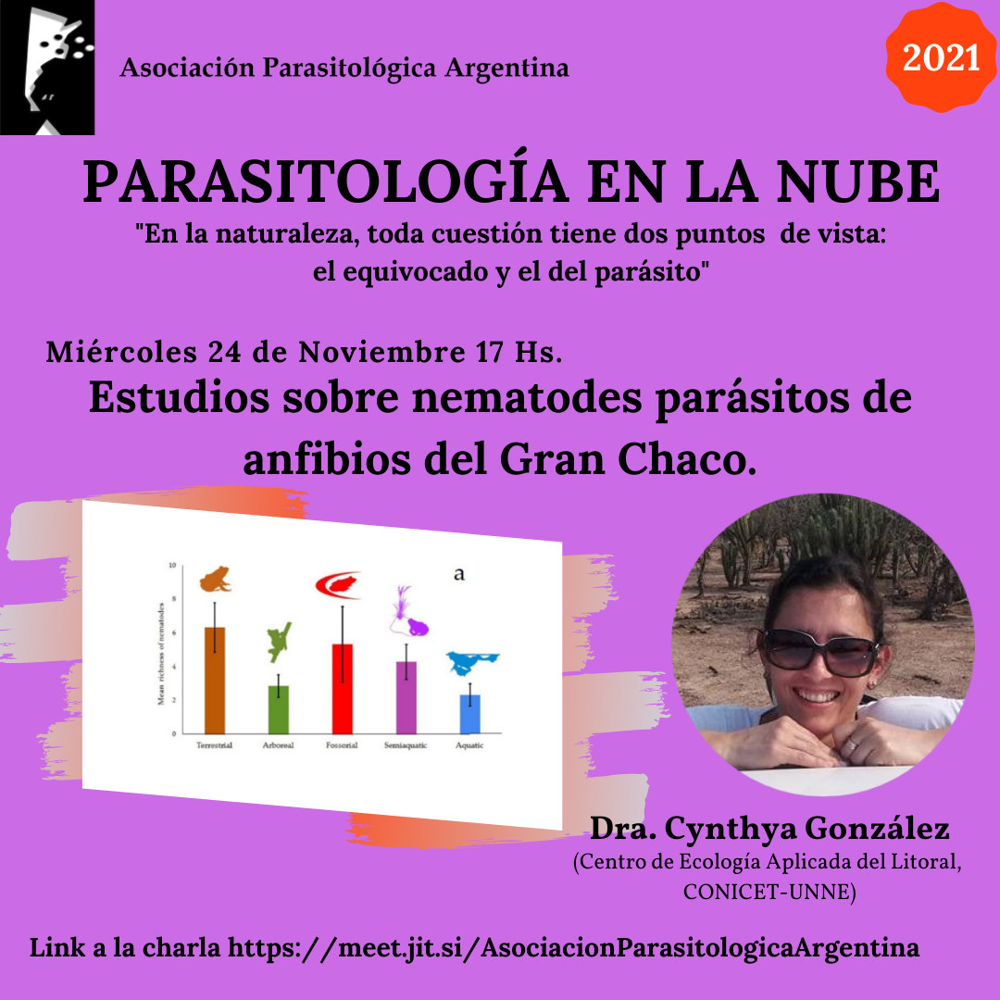

El ciclo **Parasitología en la Nube** presenta el **miércoles 24 de noviembre a las 17 h** la charla **«Estudios sobre nematodes parásitos de anfibios del Gran Chaco»**.

La expositora será la **Dra. Cynthya González**, del Centro de Ecología Aplicada del Litoral (CECOAL, CONICET-UNNE).

La actividad es abierta y en línea. [Ingresá a la charla aquí](https://meet.jit.si/AsociacionParasitologicaArgentina)
