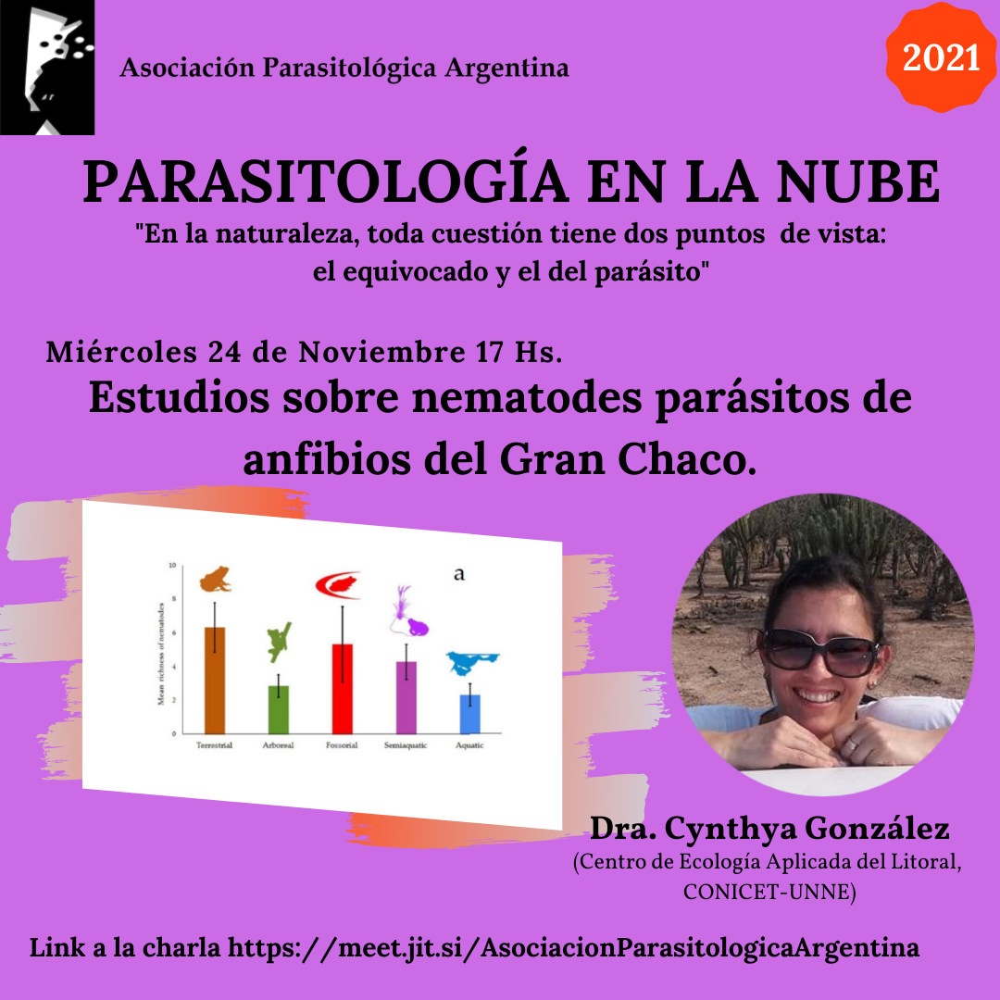

El ciclo **Parasitología en la Nube** de la APA continúa el **miércoles 24 de noviembre a las 17 h** con la charla **«Estudios sobre parásitos de anfibios en el Gran Chaco Argentino»**.

La expositora será la **Dra. Cynthya González**, del Centro de Ecología Aplicada del Litoral (CECOAL, CONICET-UNNE).

Podés ver la charla aquí:


