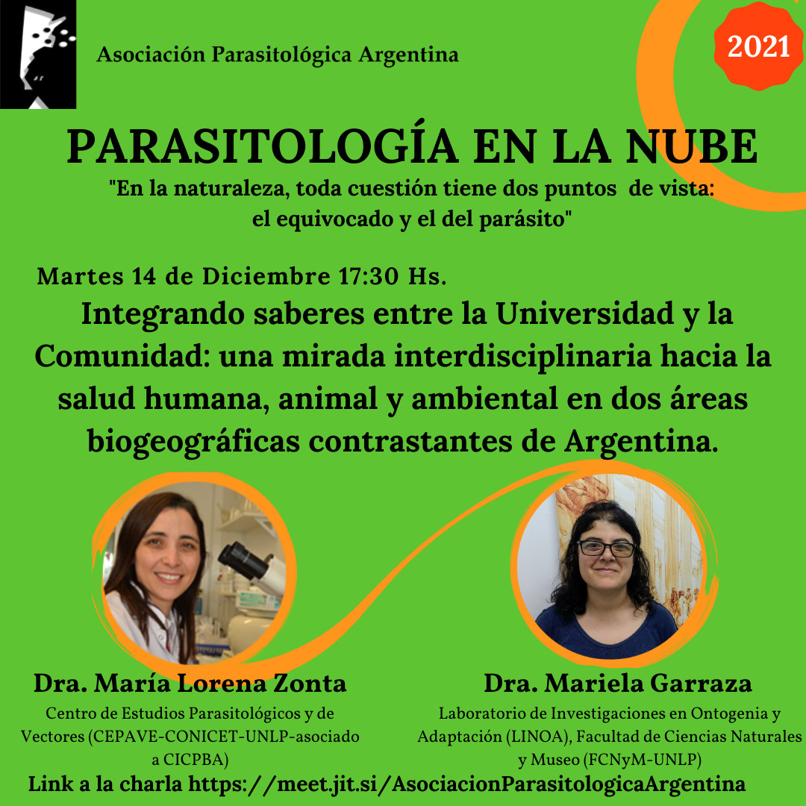

El ciclo **Parasitología en la Nube** cierra su temporada 2021 el **martes 14 de diciembre a las 17:30 h** con la charla **«Integrando saberes entre la universidad y la comunidad: una mirada interdisciplinaria hacia la salud humana, animal y ambiental en dos áreas biogeográficas contrastantes de Argentina»**.

## Expositoras

- **Dra. María Lorena Zonta**, Centro de Estudios Parasitológicos y de Vectores (CEPAVE, CONICET-UNLP, asociado a CICPBA).
- **Dra. Mariela Garraza**, Laboratorio de Investigaciones en Ontogenia y Adaptación (LINOA), Facultad de Ciencias Naturales y Museo (UNLP).

La actividad es abierta y en línea. [Ingresá a la charla aquí](https://meet.jit.si/AsociacionParasitologicaArgentina)
