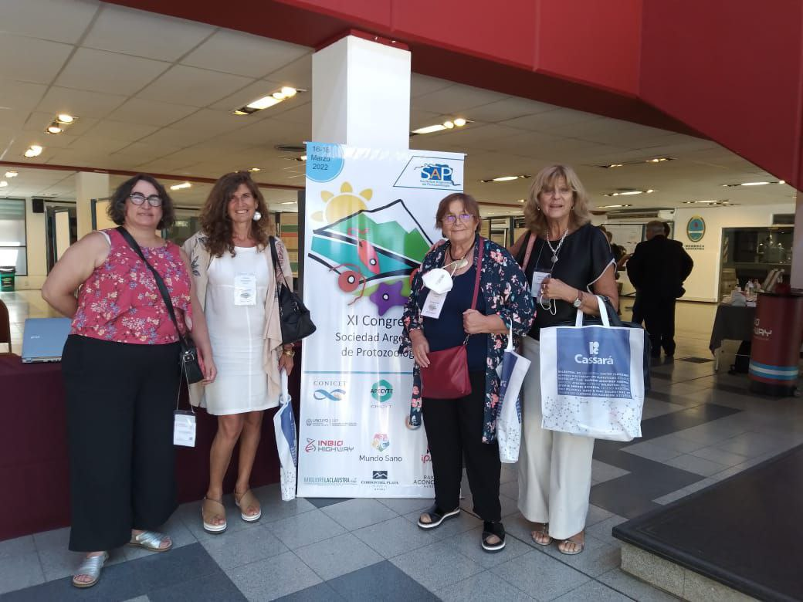

En el marco del convenio de cooperación con la Sociedad Argentina de Protozoología (SAP), la APA participó del **XI Congreso de la SAP**, realizado en **Mendoza del 16 al 18 de marzo de 2022**.

Las Dras. **Graciela T. Navone, Leonora Kozubsky, Viviana Randazzo y M. Lorena Zonta** representaron a la Asociación y organizaron el simposio **«Actualizaciones parasitológicas en Argentina»**.

## Las disertaciones

- **Viviana Randazzo:** «Zoonosis y econosis parasitarias en el sudoeste de la provincia de Buenos Aires: trichinellosis y amebas de vida libre».
- **Leonora Kozubsky:** «*Blastocystis*, un parásito ubicuo».
- **M. Lorena Zonta y Graciela T. Navone:** «Epidemiología de las parasitosis intestinales por protistas. Distribución actual de las infecciones humanas en Argentina, implicancias sanitarias».

¡Felicitaciones a todas por representar a la APA!
