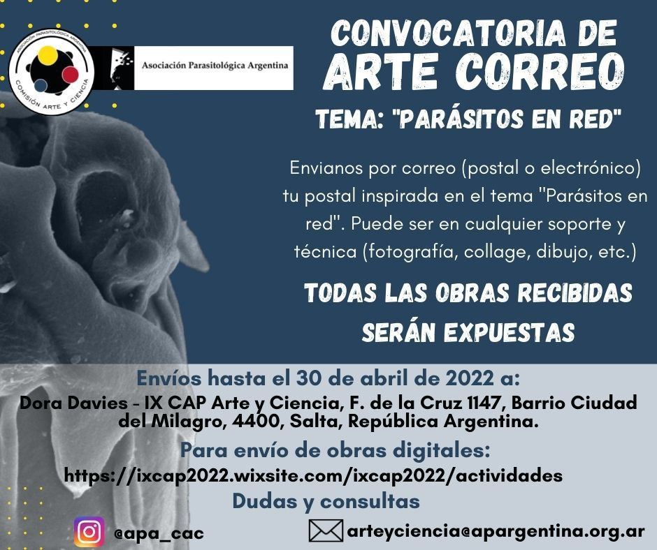

La **Comisión Arte y Ciencia de la APA** invita a participar de la **convocatoria de arte correo** del IX Congreso Argentino de Parasitología, inspirada en el lema del congreso: **«Parásitos en red»**.

La consigna es enviar una postal, por correo postal o electrónico, en cualquier soporte y técnica: fotografía, collage, dibujo y más. **Todas las obras recibidas serán expuestas** durante el congreso.

## ¿Por qué «Parásitos en red»?

Los parásitos forman redes intrincadas en los ecosistemas: distintos estadios, especies y hospedadores se entrecruzan e influyen entre sí. Las y los parasitólogos también trabajan en red, estudiando con enfoques complementarios los parásitos y sus vínculos con hospedadores y ambiente.

## Cómo participar

- **Plazo:** hasta el 30 de abril de 2022.
- **Envíos postales:** Dora Davies – IX CAP Arte y Ciencia, F. de la Cruz 1147, Barrio Ciudad del Milagro, 4400, Salta.
- **Obras digitales:** a través de la [web del IX CAP](https://ixcap2022.wixsite.com/ixcap2022/actividades).
- **Consultas:** arteyciencia@apargentina.org.ar o en Instagram, @apa_cac.

[Mirá el video de la convocatoria aquí](https://www.youtube.com/watch?v=PPDRd_vKNdg)
