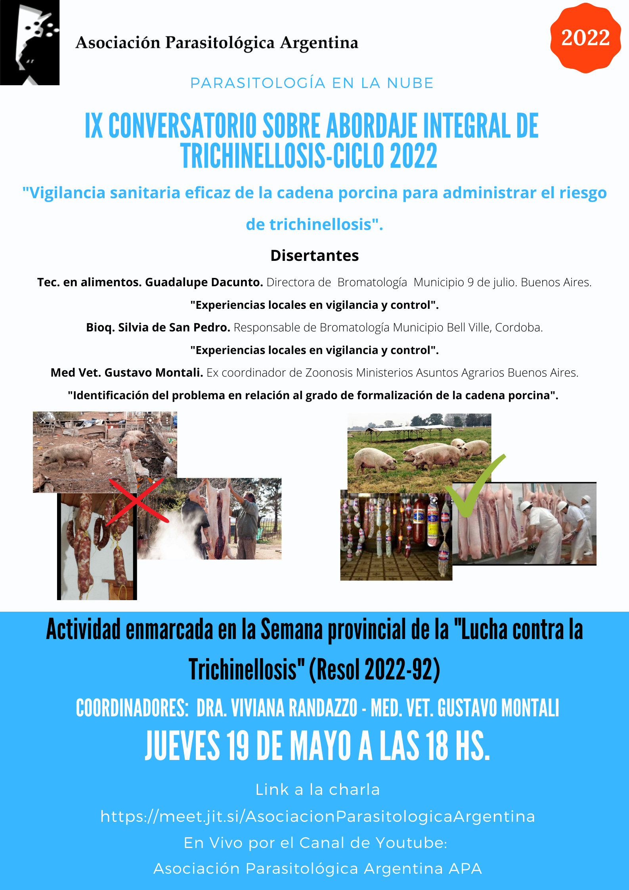

El ciclo de conversatorios de la APA sobre trichinellosis abre su temporada 2022 con el **IX Conversatorio**, dedicado a la **«Vigilancia sanitaria eficaz de la cadena porcina para administrar el riesgo de trichinellosis»**.

La cita es el **jueves 19 de mayo de 2022 a las 18 h**, en formato virtual y con transmisión en directo por el canal de YouTube de la APA. La actividad forma parte de la **Semana provincial de la Lucha contra la Trichinellosis** (Resol. 2022-92).

## Disertantes

- **Téc. Guadalupe Dacunto**, directora de Bromatología del municipio de 9 de Julio (Buenos Aires): «Experiencias locales en vigilancia y control».
- **Bioq. Silvia de San Pedro**, responsable de Bromatología del municipio de Bell Ville (Córdoba): «Experiencias locales en vigilancia y control».
- **MV Gustavo Montali**, excoordinador de Zoonosis del Ministerio de Asuntos Agrarios de Buenos Aires: «Identificación del problema en relación al grado de formalización de la cadena porcina».

**Coordinan:** Dra. Viviana Randazzo y MV Gustavo Montali.

[Ingresá al conversatorio aquí](https://meet.jit.si/AsociacionParasitologicaArgentina)
