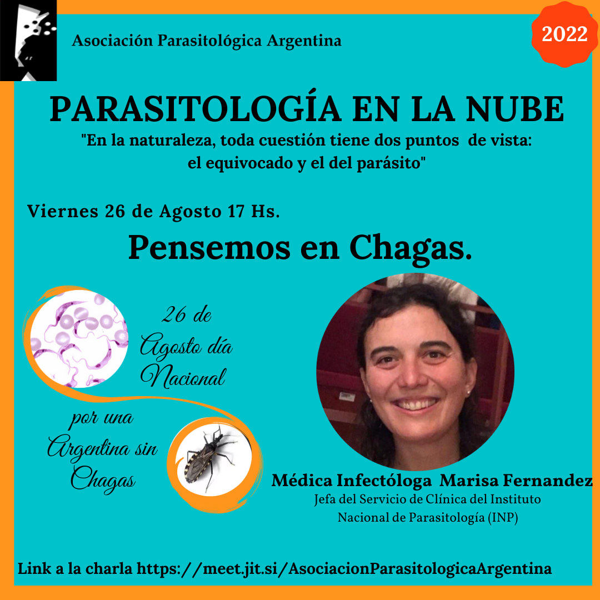

El **viernes 26 de agosto**, **Día Nacional por una Argentina sin Chagas**, el ciclo **Parasitología en la Nube** propone la charla **«Pensemos en Chagas»**, a las **17 h**.

La expositora será la médica infectóloga **Marisa Fernández**, jefa del Servicio de Clínica del **Instituto Nacional de Parasitología (INP) «Dr. Mario Fatala Chaben»**.

La actividad es abierta y en línea. [Ingresá a la charla aquí](https://meet.jit.si/AsociacionParasitologicaArgentina)
