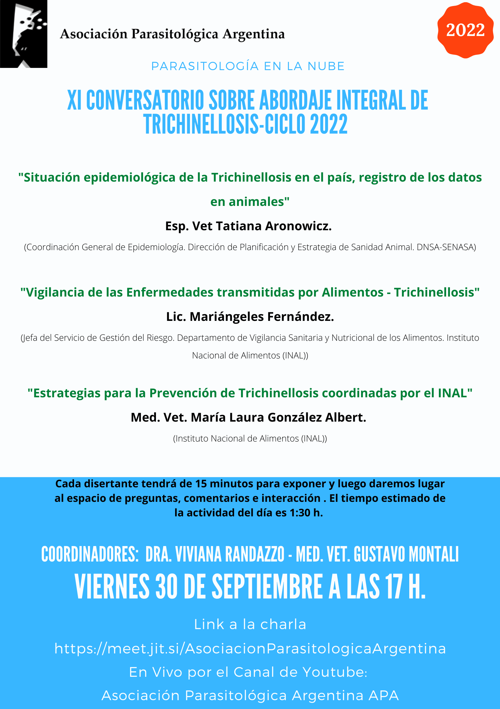

El **viernes 30 de septiembre de 2022 a las 17 h** se realizará el **XI Conversatorio sobre abordaje integral de la trichinellosis**, en formato virtual y con transmisión en directo por el canal de YouTube de la APA.

## Disertantes y temas

- **Esp. Vet. Tatiana Aronowicz** (Coordinación General de Epidemiología, DNSA-SENASA): «Situación epidemiológica de la trichinellosis en el país, registro de los datos en animales».
- **Lic. Mariángeles Fernández** (jefa del Servicio de Gestión del Riesgo, INAL): «Vigilancia de las enfermedades transmitidas por alimentos: trichinellosis».
- **MV María Laura González Albert** (INAL): «Estrategias para la prevención de trichinellosis coordinadas por el INAL».

Cada disertante expondrá durante 15 minutos y luego habrá un espacio de preguntas e intercambio. La actividad dura alrededor de una hora y media.

[Ingresá al conversatorio aquí](https://meet.jit.si/AsociacionParasitologicaArgentina)
