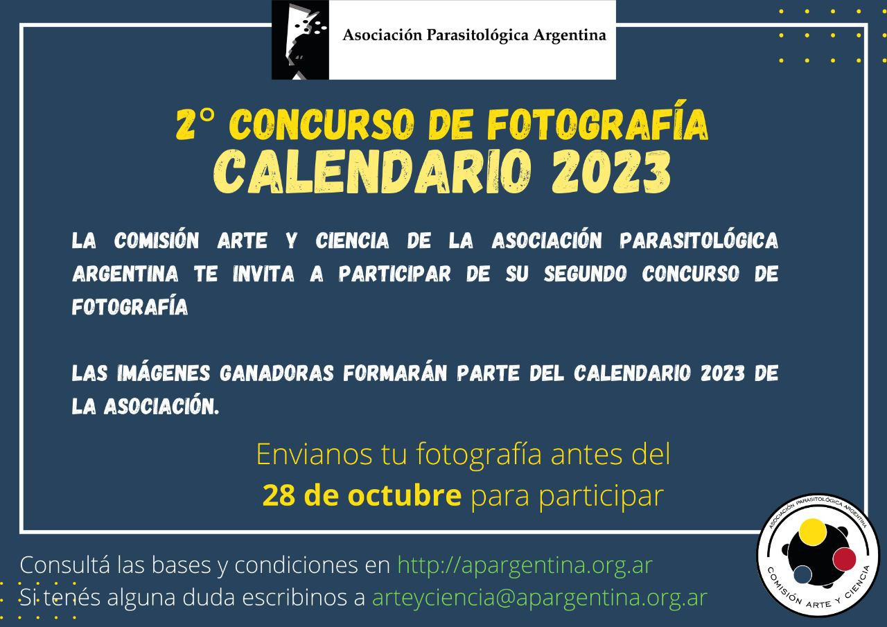

¿Tenés guardada esa foto de un parásito que te sorprendió por su belleza? La **Comisión Arte y Ciencia de la APA** lanza el **2.º Concurso de Fotografía «Arte Parasitológico»**, y las **12 imágenes ganadoras formarán parte del Calendario 2023** de la Asociación.

## Cómo participar

- **Plazo:** hasta el 28 de octubre de 2022.
- **Quiénes:** cualquier persona, sea o no socia de la APA.
- **Hasta tres fotografías por participante**, de autoría propia.
- **Qué fotografiar:** la parasitofauna de nuestro país y actividades relacionadas con la parasitología. El protagonista siempre tiene que ser el parásito. No se aceptan selfies ni fotos con personas.
- **Formato:** preferentemente horizontal, con una resolución mínima de 420 × 595 píxeles a 300 dpi, en JPG, BMP o TIFF, y de hasta 10 MB.

Todas las fotos participantes se publicarán en el Instagram de la Comisión Arte y Ciencia, y **las 12 con más «me gusta» serán las ganadoras**.

[Bases y condiciones del concurso aquí](/assets/docs/bases-calendario-2023.pdf)

[Formulario de inscripción](https://forms.gle/59haKdXQVuAFKije8)
