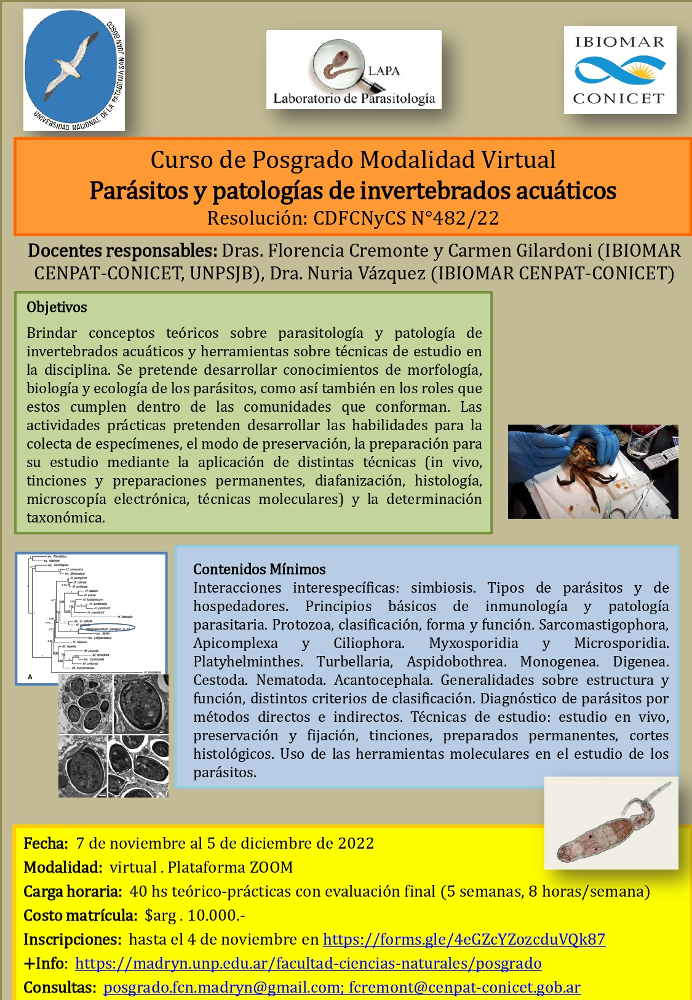

La Facultad de Ciencias Naturales y Ciencias de la Salud de la **Universidad Nacional de la Patagonia San Juan Bosco (sede Puerto Madryn)** ofrece el curso de posgrado virtual **«Parásitos y patologías de invertebrados acuáticos»** (Res. CDFCNyCS N.º 482/22), del **7 de noviembre al 5 de diciembre de 2022**.

Las docentes responsables son la **Dra. Florencia Cremonte** y la **Dra. Carmen Gilardoni** (IBIOMAR CENPAT-CONICET, UNPSJB) y la **Dra. Nuria Vázquez** (IBIOMAR CENPAT-CONICET).

## Qué se aprende

Conceptos de parasitología y patología de invertebrados acuáticos: simbiosis, tipos de parásitos y hospedadores, inmunología y patología parasitaria, y los principales grupos (protozoos, mixosporidios, microsporidios, platelmintos, nematodes y acantocéfalos). La parte práctica enseña a colectar y preservar especímenes y a prepararlos con distintas técnicas, desde el estudio in vivo y las tinciones hasta la histología, la microscopía electrónica y las herramientas moleculares.

## Datos del curso

- **Modalidad:** virtual, por Zoom.
- **Carga horaria:** 40 horas teórico-prácticas (5 semanas, 8 horas por semana), con evaluación final.
- **Matrícula:** $10.000.
- **Inscripción:** hasta el 4 de noviembre, en el [formulario en línea](https://forms.gle/4eGZcYZozcduVQk87).
- **Consultas:** posgrado.fcn.madryn@gmail.com y fcremont@cenpat-conicet.gob.ar

[Más información sobre el curso aquí](https://madryn.unp.edu.ar/facultad-ciencias-naturales/posgrado/2142-curso-de-posgrado-parasitos-y-patologias-de-invertebrados-acuaticos)
