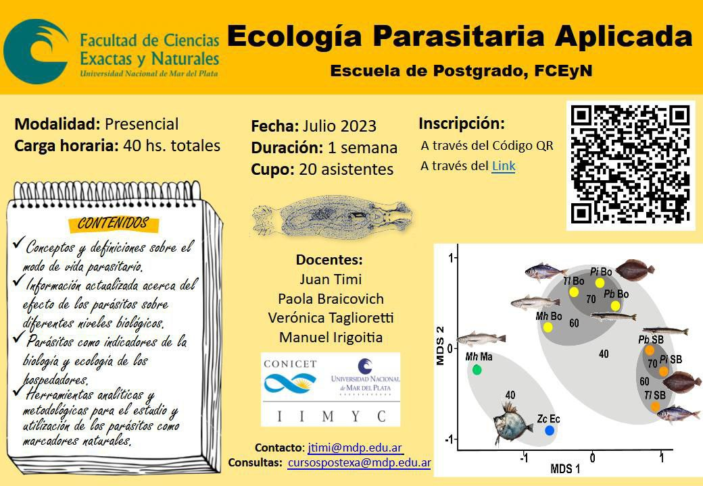

La Escuela de Posgrado de la Facultad de Ciencias Exactas y Naturales de la **Universidad Nacional de Mar del Plata** vuelve a ofrecer el curso **«Ecología Parasitaria Aplicada»**, esta vez en **modalidad presencial**, durante **una semana de julio de 2023**.

## Contenidos

- Conceptos y definiciones sobre el modo de vida parasitario.
- Información actualizada sobre el efecto de los parásitos en distintos niveles biológicos.
- Los parásitos como indicadores de la biología y la ecología de los hospedadores.
- Herramientas analíticas y metodológicas para usar los parásitos como marcadores naturales.

## Datos del curso

- **Docentes:** Juan Timi, Paola Braicovich, Verónica Taglioretti y Manuel Irigoitia (CONICET-UNMdP, IIMyC).
- **Carga horaria:** 40 horas en una semana.
- **Cupo:** 20 personas.
- **Contacto:** jtimi@mdp.edu.ar. **Consultas:** cursospostexa@mdp.edu.ar

[Inscribite al curso aquí](https://docs.google.com/forms/d/e/1FAIpQLSeNBbdMxxlJrSwECMj_w2y44aAe21KaXt4v-86E0JpwDub21w/viewform)
