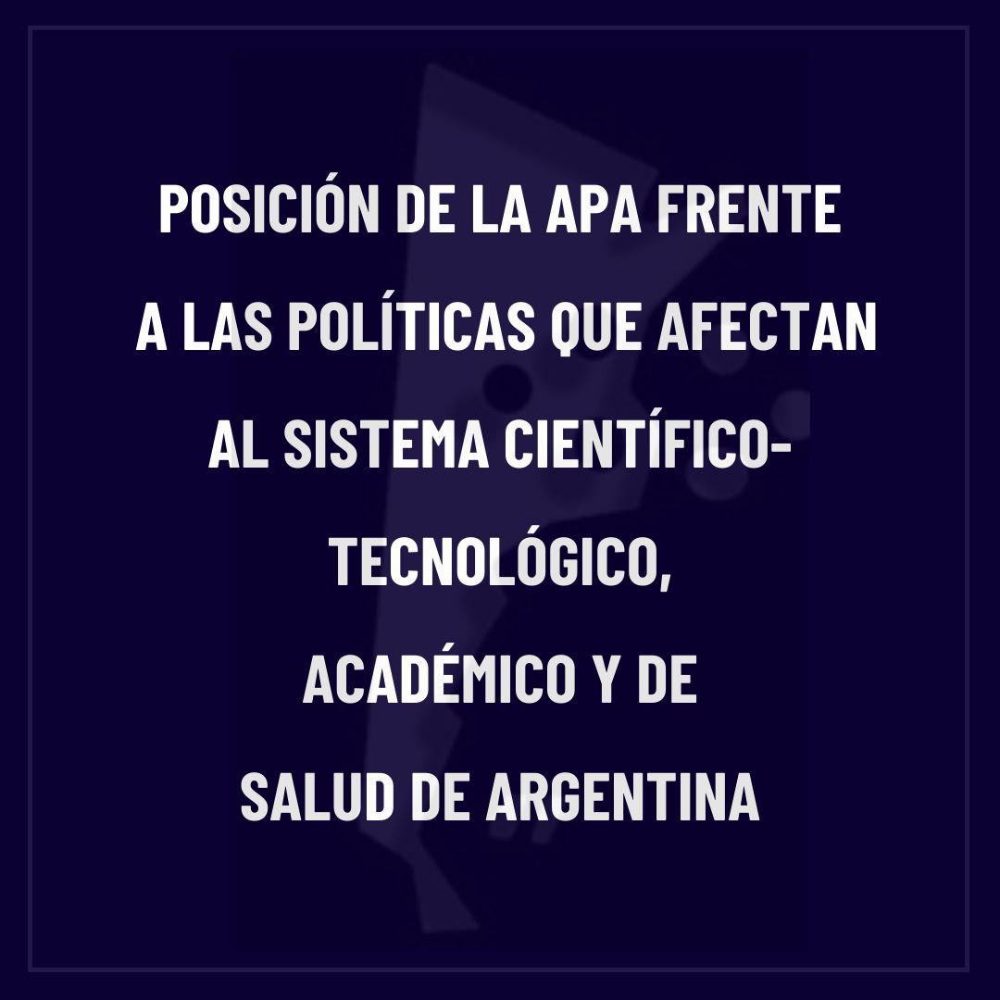
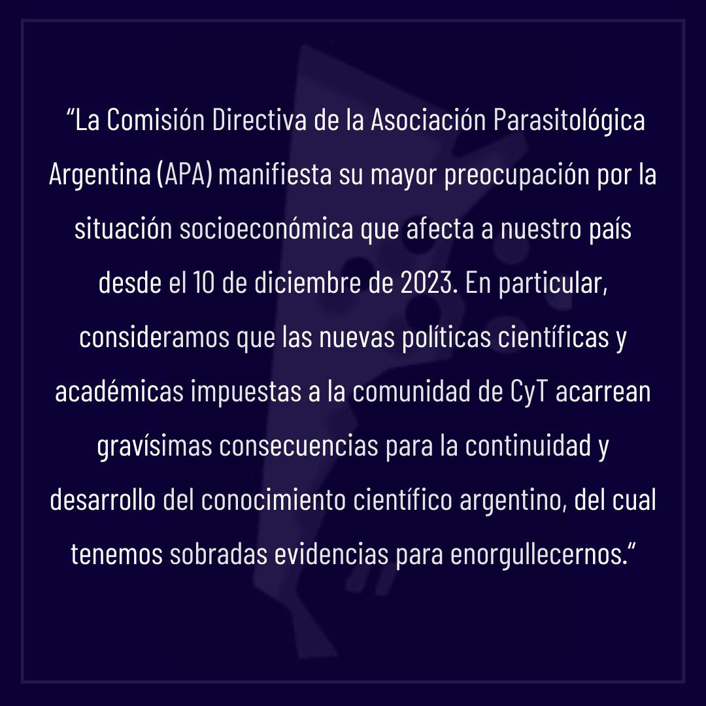

La Comisión Directiva de la **Asociación Parasitológica Argentina** difundió un comunicado en el que expresa su «mayor preocupación por la situación socioeconómica que afecta a nuestro país desde el 10 de diciembre de 2023» y por el impacto de las nuevas políticas científicas y académicas en la comunidad de ciencia y tecnología.

## Los puntos centrales del comunicado

**Quiénes integran la APA.** La Asociación reúne a profesionales de las ciencias biológicas, veterinarias, bioquímicas y médicas que generan conocimiento sobre parasitología con impacto en la salud de la población y del ambiente, en la ecología y en las actividades productivas. La mayoría trabaja en instituciones públicas de educación superior, ciencia y tecnología y salud, que según el comunicado atraviesan un «severo desfinanciamiento».

**Las consecuencias.** La APA advierte que estas políticas llevan al desmantelamiento de estructuras administrativas, a la interrupción del financiamiento, a la pérdida de poder adquisitivo y a la precarización laboral de las nuevas generaciones. Señala que ya se observan investigaciones interrumpidas, dificultades para comprar insumos y equipamiento y el inicio de una fuga de cerebros, con el riesgo de «perder una generación de científicos/as».

**El impacto en la propia Asociación.** El comunicado agrega que también se verán afectados objetivos de la APA como la formación académica continua y el espíritu de solidaridad y colaboración entre sus socias y socios.

## El pedido

> «Solicitamos imperiosamente a las autoridades de Ciencia y Educación Superior que se reviertan todas las medidas que atentan contra los sistemas científico y académico, a fin de sostener su valor estratégico para el desarrollo de nuestro país.»

