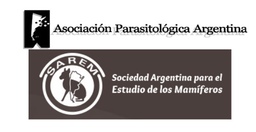

La Asociación Parasitológica Argentina comunica la entrada en vigencia del **convenio de cooperación con la Sociedad Argentina para el Estudio de los Mamíferos (SAREM)**. Ambas instituciones comparten objetivos y temas de trabajo en docencia, investigación, transferencia y gestión, en especial en torno a la parasitología de los mamíferos.

El acuerdo fue firmado por el presidente de la APA, **Dr. Juan T. Timi**, y el presidente de la SAREM, **Dr. Pablo Teta**.

## Qué cambia para socias y socios

Quienes tengan la cuota al día en su asociación **gozarán de los mismos derechos en la otra entidad** en la compra de publicaciones, los costos de cursos y las inscripciones a congresos o reuniones.

Además, ambas sociedades se comprometen a promover actividades conjuntas de docencia, investigación, transferencia y gestión.

[Leé el convenio completo aquí](/assets/docs/convenio-apa-sarem.pdf)
