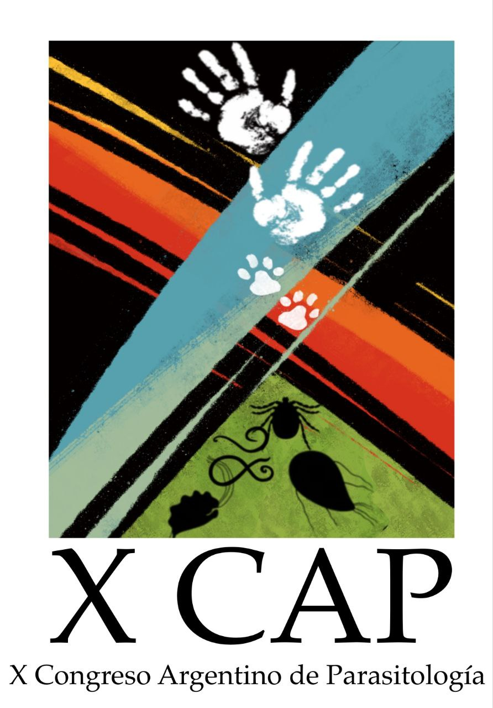

¡Reservá la fecha! El **X Congreso Argentino de Parasitología (X CAP)** se realizará del **7 al 9 de mayo de 2025** en **Puerto Iguazú, Misiones**.

El congreso tendrá como lema **«Fronteras parasitológicas entre biodiversidad y salud»**, una invitación a pensar la parasitología en un lugar donde se encuentran tres países y una de las regiones más biodiversas de Argentina.

**Contacto:** xcapiguazu2025@gmail.com
