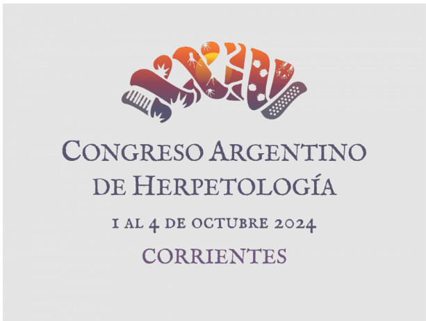

Del **1 al 4 de octubre de 2024**, la ciudad de **Corrientes** será sede del **XXIV Congreso Argentino de Herpetología**, el principal encuentro del país dedicado al estudio de anfibios y reptiles.

La APA difunde este congreso por su interés para quienes investigan a los parásitos de estos grupos de vertebrados.

[Más información en la página del congreso](https://exa.unne.edu.ar/Congreso%20de%20Herpetologia/)
