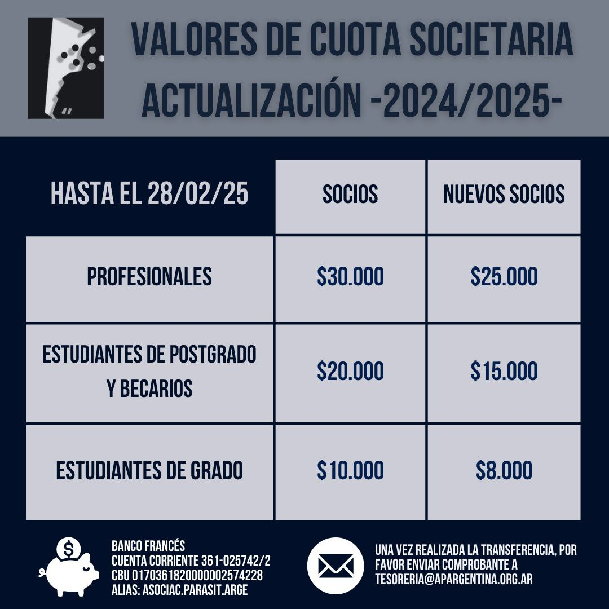

La Asociación Parasitológica Argentina informa la **actualización de la cuota societaria 2024/2025**, vigente **hasta el 28 de febrero de 2025**.

| Categoría | Socios | Nuevos socios |
|---|---|---|
| Profesionales | $30.000 | $25.000 |
| Estudiantes de posgrado y becarios | $20.000 | $15.000 |
| Estudiantes de grado | $10.000 | $8.000 |

## Cómo pagar

Por transferencia a la cuenta corriente de la APA en el Banco Francés (alias **ASOCIAC.PARASIT.ARGE**). Una vez hecha la transferencia, enviá el comprobante a tesoreria@apargentina.org.ar
