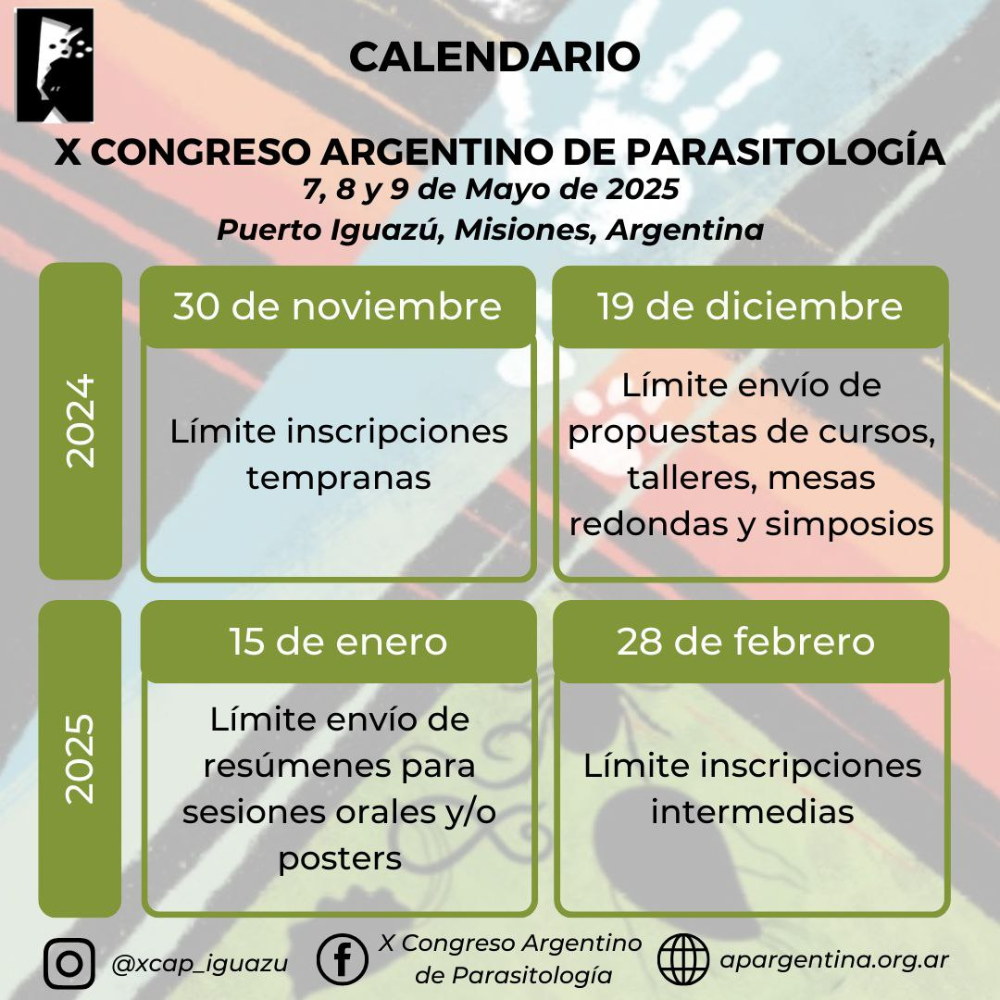

Se acerca el **X Congreso Argentino de Parasitología**, que se realizará del **7 al 9 de mayo de 2025 en Puerto Iguazú, Misiones**. Estas son las fechas que conviene agendar:

**2024**

- **30 de noviembre:** cierre de las inscripciones tempranas.
- **19 de diciembre:** límite para enviar propuestas de cursos, talleres, mesas redondas y simposios.

**2025**

- **15 de enero:** límite para enviar resúmenes para sesiones orales y pósteres.
- **28 de febrero:** cierre de las inscripciones intermedias.

Seguí las novedades en Instagram (@xcap_iguazu), en Facebook (X Congreso Argentino de Parasitología) y en esta web.
