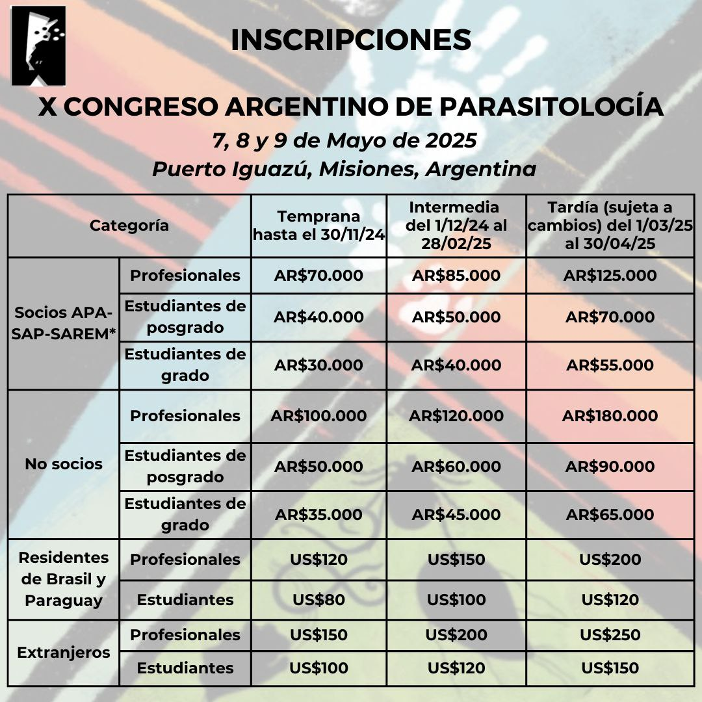

Ya están abiertas las **inscripciones al X Congreso Argentino de Parasitología**, que se realizará del **7 al 9 de mayo de 2025 en Puerto Iguazú, Misiones**. Gracias a los convenios vigentes, **los socios de la Sociedad Argentina de Protozoología (SAP) y de la Sociedad Argentina para el Estudio de los Mamíferos (SAREM) acceden a los mismos valores que los socios de la APA**.

## Aranceles

| Categoría | Temprana (hasta 30/11/24) | Intermedia (1/12/24 al 28/2/25) | Tardía (1/3 al 30/4/25) |
|---|---|---|---|
| Socios APA-SAP-SAREM – Profesionales | AR$ 70.000 | AR$ 85.000 | AR$ 125.000 |
| Socios APA-SAP-SAREM – Estudiantes de posgrado | AR$ 40.000 | AR$ 50.000 | AR$ 70.000 |
| Socios APA-SAP-SAREM – Estudiantes de grado | AR$ 30.000 | AR$ 40.000 | AR$ 55.000 |
| No socios – Profesionales | AR$ 100.000 | AR$ 120.000 | AR$ 180.000 |
| No socios – Estudiantes de posgrado | AR$ 50.000 | AR$ 60.000 | AR$ 90.000 |
| No socios – Estudiantes de grado | AR$ 35.000 | AR$ 45.000 | AR$ 65.000 |
| Residentes de Brasil y Paraguay – Profesionales | US$ 120 | US$ 150 | US$ 200 |
| Residentes de Brasil y Paraguay – Estudiantes | US$ 80 | US$ 100 | US$ 120 |
| Extranjeros – Profesionales | US$ 150 | US$ 200 | US$ 250 |
| Extranjeros – Estudiantes | US$ 100 | US$ 120 | US$ 150 |

Los valores de la inscripción tardía pueden sufrir cambios.

[Toda la información del congreso aquí](https://apargentina.org.ar/x-congreso-argentino-de-parasitologia/)
