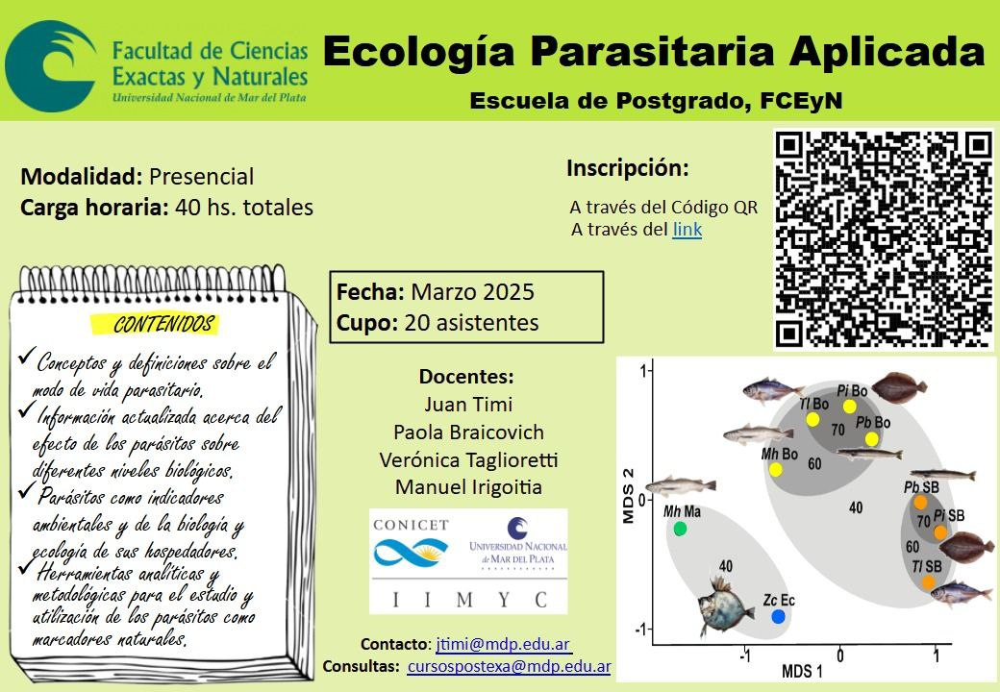

La Escuela de Posgrado de la Facultad de Ciencias Exactas y Naturales de la **Universidad Nacional de Mar del Plata** abre una nueva edición del curso **«Ecología Parasitaria Aplicada»**, en **modalidad presencial**, en **marzo de 2025**.

## Contenidos

- Conceptos y definiciones sobre el modo de vida parasitario.
- Información actualizada sobre el efecto de los parásitos en distintos niveles biológicos.
- Los parásitos como indicadores ambientales y de la biología y la ecología de sus hospedadores.
- Herramientas analíticas y metodológicas para usar los parásitos como marcadores naturales.

## Datos del curso

- **Docentes:** Juan Timi, Paola Braicovich, Verónica Taglioretti y Manuel Irigoitia (CONICET-UNMdP, IIMyC).
- **Carga horaria:** 40 horas.
- **Cupo:** 20 personas.
- **Inscripción:** mediante el código QR del afiche.
- **Contacto:** jtimi@mdp.edu.ar. **Consultas:** cursospostexa@mdp.edu.ar
