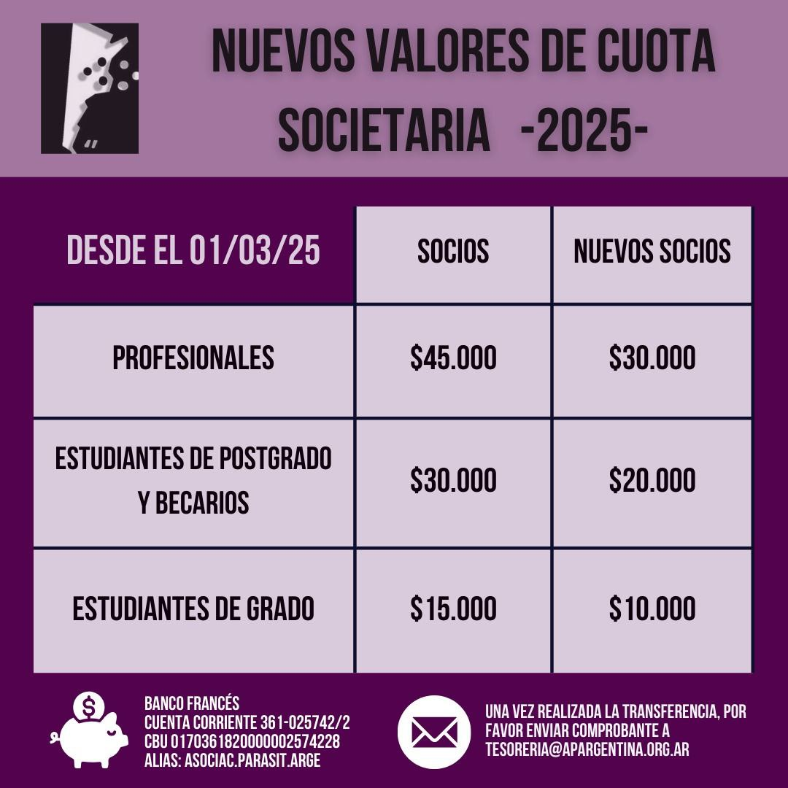

La Asociación Parasitológica Argentina informa los **nuevos valores de la cuota societaria 2025**, vigentes **desde el 1 de marzo de 2025**.

| Categoría | Socios | Nuevos socios |
|---|---|---|
| Profesionales | $45.000 | $30.000 |
| Estudiantes de posgrado y becarios | $30.000 | $20.000 |
| Estudiantes de grado | $15.000 | $10.000 |

## Cómo pagar

Por transferencia a la cuenta corriente de la APA en el Banco Francés (alias **ASOCIAC.PARASIT.ARGE**). Una vez hecha la transferencia, enviá el comprobante a tesoreria@apargentina.org.ar
