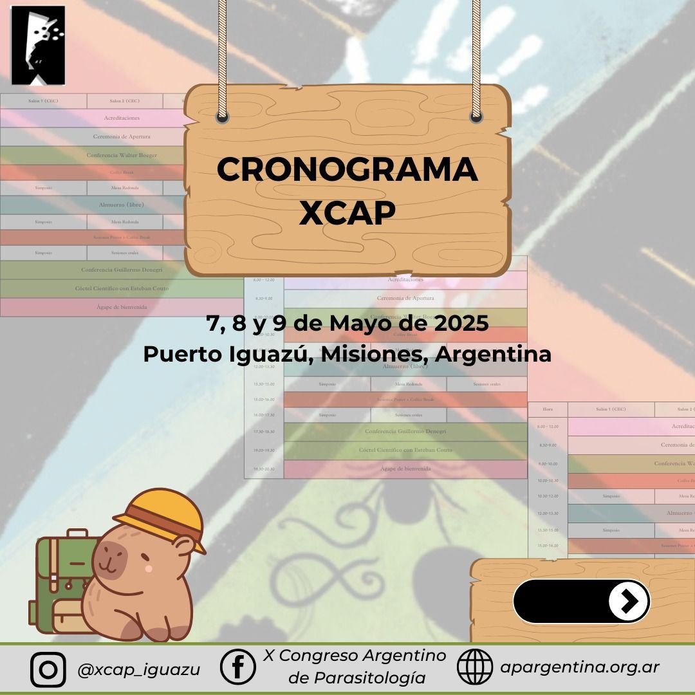
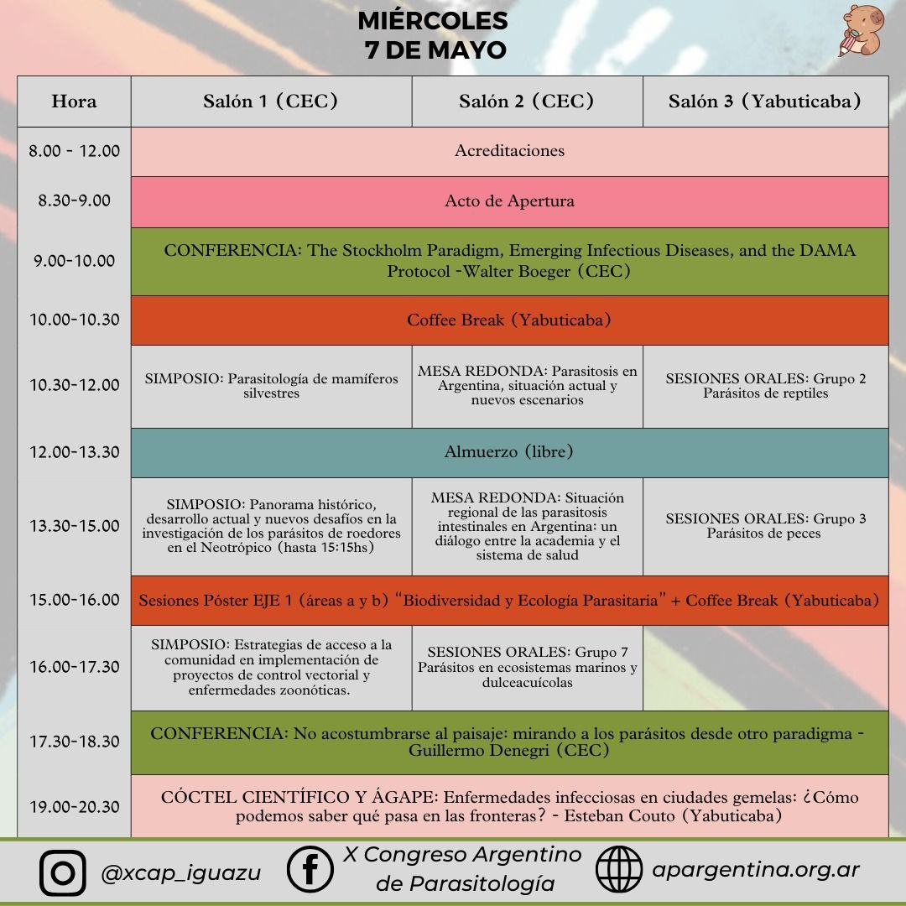
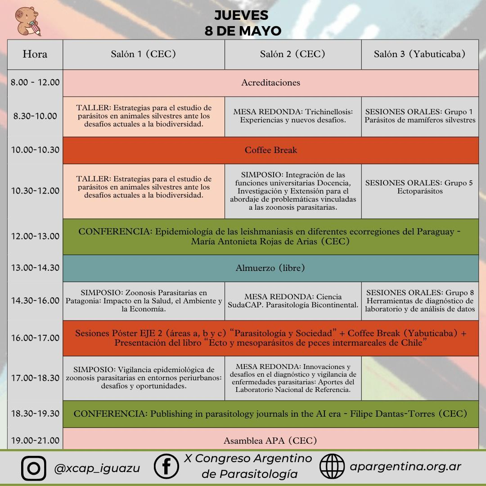
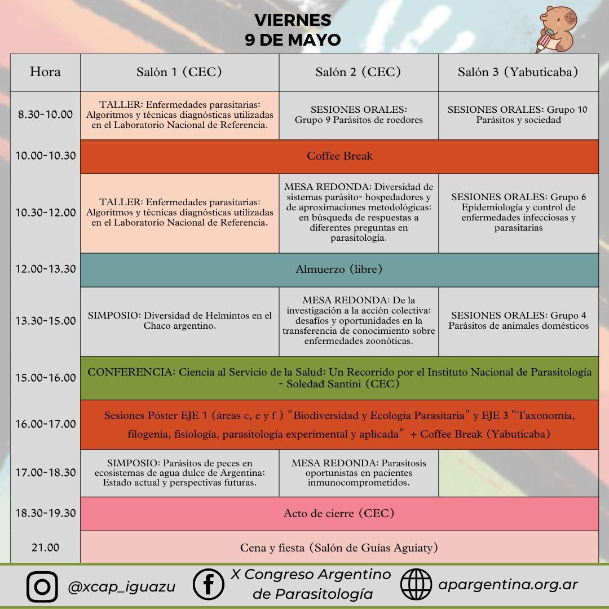

Ya está disponible el **cronograma del X Congreso Argentino de Parasitología**, que se realizará del **7 al 9 de mayo de 2025 en Puerto Iguazú, Misiones**. Las actividades se desarrollarán en dos salones del Centro de Convenciones (CEC) y en el salón Yabuticaba.

## Miércoles 7 de mayo

Tras la apertura, la conferencia inaugural estará a cargo de **Walter Boeger**: «The Stockholm Paradigm, Emerging Infectious Diseases, and the DAMA Protocol». Durante el día habrá simposios sobre parasitología de mamíferos silvestres, parásitos de roedores en el Neotrópico y control vectorial; mesas redondas sobre la situación de las parasitosis en Argentina y las parasitosis intestinales; y la conferencia **«No acostumbrarse al paisaje: mirando a los parásitos desde otro paradigma»**, de **Guillermo Denegri**. La jornada cierra con un cóctel científico sobre enfermedades infecciosas en ciudades gemelas de frontera, a cargo de **Esteban Couto**.

## Jueves 8 de mayo

Talleres sobre el estudio de parásitos en animales silvestres; mesas redondas sobre trichinellosis, la «Ciencia SudaCAP» y el diagnóstico en el Laboratorio Nacional de Referencia; y simposios sobre zoonosis parasitarias en Patagonia y en entornos periurbanos. Habrá dos conferencias: **María Antonieta Rojas de Arias** hablará de la epidemiología de las leishmaniasis en Paraguay y **Filipe Dantas-Torres**, de cómo publicar en revistas de parasitología en la era de la inteligencia artificial. Por la noche se realizará la **Asamblea de la APA**.

## Viernes 9 de mayo

Taller sobre algoritmos y técnicas diagnósticas del Laboratorio Nacional de Referencia; simposios sobre helmintos del Chaco argentino y parásitos de peces de agua dulce; y mesas redondas sobre la transferencia de conocimiento en zoonosis y las parasitosis oportunistas en pacientes inmunocomprometidos. La conferencia de cierre, **«Ciencia al servicio de la salud: un recorrido por el Instituto Nacional de Parasitología»**, estará a cargo de **Soledad Santini**. El congreso termina con una cena y fiesta en el Salón de Guías Aguiaty.

Seguí las novedades del congreso en Instagram: @xcap_iguazu.
